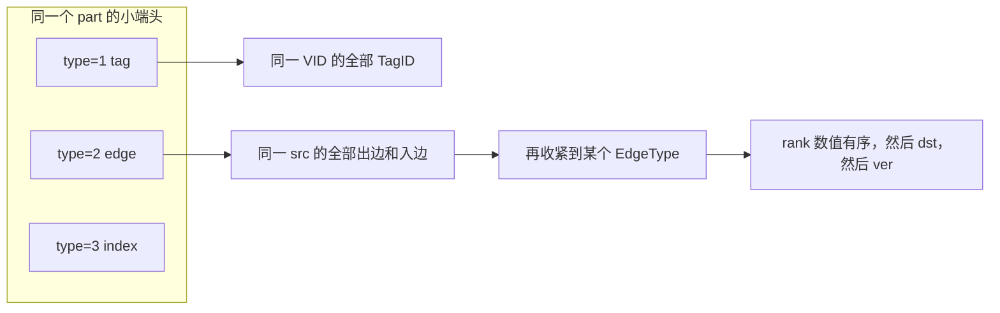

# 06 — 存储 key：点、边、系统键与 VID

> 源码基线与 [README](README.md) 相同：master `426266b5`，对照 tag `v3.8.0`。
> 本文只写 RocksDB key 的字节布局。行 value 见 [07](07-row-encoding.md)，索引列编码见 [08](08-index-key-encoding.md)。
> 过滤表达式怎么进 storaged 已写在 [04-storage-execution](04-storage-execution.md)，这里不重复。
> `src/common/utils/NebulaKeyUtils.h`、`NebulaKeyUtils.cpp`、`Types.h` 在 `v3.8.0` 与 master 之间没有 diff。
> 分析日期：2026-10-26

---

## 0. 先记住的三件事

1. 文件头注释写的是 `type(1) + partId(3)`。实现是把 `(partId << 8) | type` 按主机字节序写入 4 字节，没有调用 `folly::Endian`。在小端上，第一个字节才是 type，后三个字节才是 partId 的低、中、高字节。Nebula 的发行目标是小端；下面的图按小端画。源码里没有大端分支。
2. VID 在 key 里永远是定长字节。`INT64` 空间的长度必须是 8（`CreateSpaceProcessor`），图侧把它的二进制原样放进这 8 字节。`FIXED_STRING` 不足长度时用 `'\0'` 补齐。
3. 边 key 的 rank 和索引里的整数一样，先翻转符号位再按大端写入，所以同一条出边上的 rank 按数值有序。TagID、EdgeType 则是主机序，不保证按数值相邻。

---

## 1. 类型字节

`src/common/utils/Types.h` 里 `NebulaKeyType` 是 `uint32_t`，低 8 位才是类型。`kPartitionOffset = 8`，`kTypeMask = 0xFF`。`static_assert(sizeof(NebulaKeyType) == sizeof(PartitionID))`，两者都是 4 字节（`PartitionID` 是 `int32_t`，`src/common/thrift/ThriftTypes.h`）。

| 枚举 | 值 | 谁来组 key |
|------|----|------------|
| `kTag_` | 1 | `NebulaKeyUtils::tagKey` |
| `kEdge` | 2 | `NebulaKeyUtils::edgeKey` |
| `kIndex` | 3 | `IndexKeyUtils::vertexIndexKeys` / `edgeIndexKeys` |
| `kSystem` | 4 | `systemCommitKey` / `systemPartKey` / `systemBalanceKey` |
| `kOperation` | 5 | `OperationKeyUtils`，索引重建的操作日志 |
| `kKeyValue` | 6 | `NebulaKeyUtils::kvKey` |
| `kVertex` | 7 | `NebulaKeyUtils::vertexKey`，`FLAGS_use_vertex_key` 默认 false |
| `kPrime` | 8 | `ConsistUtil::primeTable`，TOSS |
| `kDoublePrime` | 9 | `ConsistUtil::doublePrimeTable`，TOSS |

`getPart` 把前 4 字节读成 `PartitionID` 再 `>> 8`。小端上这等于把后三个字节拼回 partId。partId 只占高 24 位，代码没有再对 partId 做掩码。分区号在实际建空间时远小于 2^24，超出这个宽度会截断 partId 自己的高位（不会和 type 重叠——type 固定在低 8 位）；源码里没有看到单独的上限检查。

小端上的 4 字节头：

```
偏移  0        1              2               3
     +--------+--------------+---------------+----------------+
     | type   | partId[7:0]  | partId[15:8]  | partId[23:16]  |
     +--------+--------------+---------------+----------------+
```

因此 RocksDB 的字典序先按 type，再按 partId 的小端字节。同一个 part 的 tag、edge、index 并不挨在一起；同一种 type 里，part 256（字节 `00 01 00`）会排在 part 1（字节 `01 00 00`）前面。前缀扫描必须用完整的 4 字节头，不能假设「partId 数值相邻 ⇒ key 相邻」。

`firstKey(prefix, count)` 在前缀后补 `count` 个 `'\0'`，`lastKey` 补 `'\377'`。点、边的范围迭代用这两个哨兵。

---

## 2. VID 怎么变成定长字节

空间只允许两种 vid 类型，`CreateSpaceProcessor::process`：

- `INT64` 且 `type_length == 8`，否则 `E_INVALID_PARM`。
- `FIXED_STRING`，`type_length != 0`。长度写回 `vid_type.type_length`，成为 `spaceVidLen`。

`InsertVerticesValidator::prepareVertices` 用 `SchemaUtil::toVertexID` 检查字面量类型，把 `Value` 放进 `storage::cpp2::NewVertex.id`。真正变成 key 字节是在 graphd 的 `StorageClient::getIdFromNewVertex`：

- `INT64`：`std::string(reinterpret_cast<const char*>(&id.getInt()), 8)`。8 字节是主机序整数，小端上低字节在前。没有转成十进制文本。
- `FIXED_STRING`：直接用 `Value` 里的字符串，此时还不补齐。

`MetaClient::partId` 用这个字节串算分区：长度恰好是 8 时，把 8 字节 `memcpy` 成 `uint64_t`，再 `vid % numParts + 1`。注释写明这是为了兼容 1.0。长度不是 8 时走 `MurmurHash2`。所以：

- 整数 VID 的分区是这 8 字节按 `uint64_t` 解释后取模。负数的补码会变成很大的无符号数，分区不按有符号数值取模。热点整数会堆在同一个 part。
- `FIXED_STRING(8)` 的每个 VID 也是 8 字节，会走进同一条整数分支，而不是 MurmurHash。这是源码里的行为，不是文档推断。长度不是 8 的字符串 VID 才哈希。

storaged 收到请求后 `AddVerticesProcessor` 取 `vertex.get_id().getStr()`，`NebulaKeyUtils::isValidVidLen` 只要求 `vid.size() <= spaceVidLen`。`tagKey` 再 `append(vIdLen - vId.size(), pad)`，默认 pad 是 `'\0'`。

读回来时 `QueryUtils::readVertexProp`：

- `isIntId`：把 VID 槽前 8 字节读成 `int64_t`。
- 否则：`subpiece(0, find_first_of('\0'))`，在第一个 `'\0'` 处截断。VID 正文里不能含 `'\0'`，否则读出来会变短。源码没有另外的转义。

`GetNeighborsNode::doExecute` 把第一列写成这个 `int64` 或原始字符串。`storage.thrift` 里 `GetNeighborsResponse` 的注释仍写「`_vid` 的类型应是 string」。整数空间的实际第一列是 `i64`。以 `GetNeighborsNode` 为准。

---

## 3. Tag key 与 vertex key

`NebulaKeyUtils::tagKey`（`NebulaKeyUtils.cpp`）：

```
| type|partId (4) | VID (spaceVidLen，不足补 pad) | TagID (4，主机序) |
```

`kTagLen = sizeof(PartitionID) + sizeof(TagID) = 8`。整条 key 长度是 `kTagLen + vIdLen`。`isTag` 用这个长度判断。

`TagID` 是 `int32_t`，`memcpy` 进 key，没有 `Endian::big`。小端上 TagID 1 的字节是 `01 00 00 00`，TagID 256 是 `00 01 00 00`，数值更大的 TagID 可能排在更小的前面。同一个点的多个 tag 仍落在 `tagPrefix(vIdLen, partId, vId)` 这一段里，因为前缀停在 VID 之前；只是 tag 之间的顺序不是 TagID 的数值序。

`vertexKey` 是 `kVertex` 头加 VID，没有 TagID。`FLAGS_use_vertex_key`（`StorageFlags.cpp`）和 `FLAGS_graph_use_vertex_key`（`GraphFlags.cpp`）默认都是 false。打开时 `AddVerticesProcessor` 会额外写一条 value 为空的 vertex key。`GetPropNode` 的注释写了两种「点是否存在」的判断：flag 开时查 vertex key，关时扫该 VID 的 tag 前缀。本文不展开这个 flag 的查询语义。

---

## 4. Edge key：方向、rank、版本字节

`NebulaKeyUtils::edgeKey`：

```
| type|partId (4) | src VID | EdgeType (4，主机序) | rank (8，有序编码) | dst VID | ver (1) |
```

`kEdgeLen = 4 + 4 + 8 + 1 = 17`。整条 key 长度是 `kEdgeLen + 2 * vIdLen`。`isEdge` 还要求最后一个字节等于 `suffix`，默认 `kEdgeVersion = 1`。

头注释里的 `placeHolder(1)` 就是这个版本字节。`toEdgeKey` / `toLockKey` 的注释：

- 没开 MVCC 时，锁的版本是 `kLockVersion = 0`，数据边的版本是 1。
- 开了 MVCC 时两边版本相同。`getLockVersion` 的实现直接 `return 0`，没有读 key。
- `keyWithNoVersion` 去掉最后 1 字节，注释里的 TODO 说如果改成 varint 版本就要改这里。当前版本是定长 1 字节。

rank 与索引整数共用一套变换，`NebulaKeyUtils::encodeRank`：

```text
rank ^= 1 << 63
按大端写出 8 字节
```

`decodeRank` 先按大端读回再异或。负数的符号位原来是 1，异或后变 0，所以负数排在正数前面，同一符号内按数值大小排。这是边 key 里唯一按数值有序的整数域。

方向不靠单独的 flag。`InsertEdgesValidator::prepareEdges` 对一条逻辑边写两个 `NewEdge`：正向 `edge_type = edgeType_`，反向把 src/dst 对调且 `edge_type = -edgeType_`。`storage.thrift` 的 `EdgeKey` 注释：`edge_type > 0` 是出边，否则是入边。`AddEdgesProcessor` 对每个 `EdgeKey` 调一次 `edgeKey`，所以一条逻辑边是两行 KV。反向边的 src 是原 dst，`StorageClient` 按 src 做 `partId`，因此入边落在原 dst 的分区，不出边的那个 part。

`EdgeType` 是主机序。小端上 `+1` 是 `01 00 00 00`，`-1` 是 `FF FF FF FF`。同一个 src 下，出边和入边不会按 `|type|` 成对相邻。要扫某个点的全部出边，用 `edgePrefix(vIdLen, partId, srcId, positiveType)`；正负 type 的前缀不同。扫这个点的所有边（不论方向）用停在 src VID 之后的 `edgePrefix`。

版本字节在最后，`0 < 1`，所以同一条边的锁 key 排在数据 key 前面。

---

## 5. 系统键、KV、操作日志、TOSS

这些 key 都复用同一个 4 字节头，type 不同。

| Key | 布局 | 函数 |
|-----|------|------|
| commit / part / balance | 4 字节头 + `NebulaSystemKeyType`（4 字节主机序） | `systemCommitKey` 等。`kSystemLen = 8` |
| 用户 KV | 头 + name 原文 | `kvKey` |
| 索引重建 modify | 头 + 大端微秒时间戳 + `kModify` + 被操作的索引 key | `OperationKeyUtils::modifyOperationKey` |
| 索引重建 delete | 头 + 大端时间戳 + `kDelete`。被删的索引 key 在 value 里 | `deleteOperationKey` |
| prime / double prime | 4 字节 `kPrime` 或 `kDoublePrime` 头，再拼一条完整 edge key | `ConsistUtil::primeKey` / `doublePrime` |
| data version | 字面量 `"\xFF\xFF\xFF\xFF"`，value 是 `"3.0"` | `dataVersionKey` / `dataVersionValue` |

`NebulaSystemKeyType`：commit = 1，part = 2，balance = 3。它们是 storaged 分区内部的系统行，不是 metad 的 schema。

TOSS（`IsolationLevel::TOSS`）在 `InsertEdgesValidator::toPlan` 里会把 `useChainInsert` 置 true——但 **v3.8.0 里这个标记没有读者**：`useChainInsert()` 零调用者，`InsertEdgesExecutor` 硬编码 `useExperimentalFeature=false`，所以 INSERT EDGE 实际走不到 chain processor，prime key 也不会被写。prime key 是「本 part 的 prime 前缀 + 一条 edge key」。恢复时 `edgeKeyFromPrime` 丢掉前 4 字节。锁和 prime 的状态机不在本文展开；key 的形状就这些。

---

## 6. metad 的 key 是另一套

metad 不走 `NebulaKeyType`。`MetaKeyUtils.cpp` 的 `tableMaps` / `systemTableMaps` 用字符串前缀，例如：

| 前缀 | 内容 |
|------|------|
| `__spaces__` | spaceId → `SpaceDesc` |
| `__parts__` | spaceId + partId → hosts |
| `__tags__` | spaceId + tagId + `SchemaVer` |
| `__edges__` | spaceId + edgeType + `SchemaVer` |
| `__indexes__` | spaceId + indexId |
| `__users__`、`__zones__`、`__leaders__` 等 | 账号、zone、leader |

`schemaTagKey` 是 `__tags__` + `GraphSpaceID` + `TagID` + `SchemaVer`，整数都是主机序——但版本号存的是**反转值**（`max() - version`，`MetaKeyUtils.cpp:596-605`），所以更新的版本排在前面。`CreateTagProcessor` 写 version 0。`AlterTagProcessor` 取当前最大 version 再 `+ 1`，插入新 key，不改旧 key。旧数据行怎么对着这些版本读，见 [07](07-row-encoding.md)。

---

## 7. 前缀扫描实际扫到什么



- 取一个点的全部 tag：`tagPrefix(vIdLen, partId, vId)`。TagID 的遍历顺序是小端字节序。
- 取一个点的全部边：`edgePrefix(vIdLen, partId, src)`。超级点就是这条前缀很长。边在 src 的 part 上，不跨 part。
- 只取出边：前缀再加正的 `EdgeType`。入边在对端点的 part 上，是另一条前缀。
- 同 type、同 src 下按 rank 有序，因为 rank 做了符号位翻转和大端。`GO` 的存储执行见 [04](04-storage-execution.md) 的 `GetNeighbors`，它按这条前缀读，再在边上跑 filter。

`dumpBadKey` 在长度不符时 `LOG(FATAL)` 并打 hex。key 长度是 VID 长度的函数，space 的 `vid_len` 和数据不一致会直接失败，而不是跳过。
