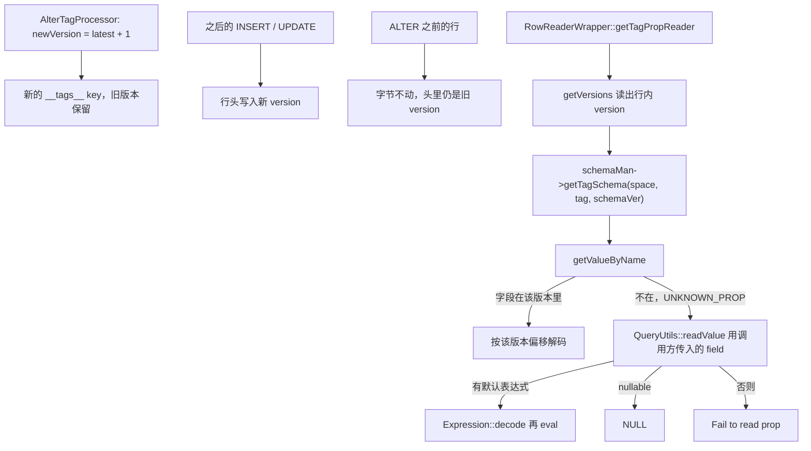

# 07 — 行 value：RowWriterV2、schema 版本、默认值与 TTL

> 源码基线与 [06-key-encoding](06-key-encoding.md) 相同。
> 行格式在 `src/codec/RowWriterV2.h`、`RowWriterV2.cpp`、`RowReaderV2.cpp`、`RowReaderWrapper.cpp`，字段宽度在 `src/common/meta/NebulaSchemaProvider.cpp`。
> `v3.8.0` 与 master 的 key 编码相同。行格式的差别是 master 多了 LIST / SET，见第 6 节。
> 分析日期：2026-10-26

---

## 0. 行里有什么

`BaseProcessor::encodeRowVal`（`src/storage/BaseProcessor-inl.h`）对最新 schema 构造 `RowWriterV2`，按属性名或下标 `setValue`，然后 `finish()`。写进 RocksDB 的 value 就是 `moveEncodedStr()`。

`RowWriterV2.h` 里的总图：

```
| header 1B | schema version 0..7B | null bitmap | 定长字段区 | 变长尾巴 | 时间戳 8B |
```

定长字段区的长度是 `NebulaSchemaProvider::size()`，等于最后一个字段的 `offset + size`。字段按下标紧挨着排，没有对齐填充。null bitmap 只给 nullable 字段留位，非空字段不占 bit。

---

## 1. Header 与两代编码器

第一个字节同时表示编码器版本和 schema version 占几字节。`RowReaderWrapper::getVersions`：

```text
readerVer = ((byte0 & 0x18) >> 3) + 1
```

| 编码器 | 头字节布局 | 版本字节数 |
|--------|------------|------------|
| v1 | `vvv 00 bbb`，高 3 位是 schema version 字节数，低 3 位是 block offset 字节数，中间两位必须是 0 | `byte0 >> 5` |
| v2 | `000 01 vvv`，高 3 位保留，中间两位是编码器版本，低 3 位是 schema version 字节数 | `byte0 & 0x07` |

v2 的设计目标写在头文件里：每个属性在字段区内的宽度由类型决定，按下标算偏移是 O(1)。v1 要靠 block offset。生产路径 `RowReaderWrapper` 的构造函数 `CHECK_EQ(readerVer, 2)`。v1 写入只存在 `src/codec/test/RowWriterV1.cpp`，当前写入不会产生 v1 行。`getVersions` 仍能识别 v1 头，但 wrapper 不会把它交给 `RowReaderV2`。

v2 写入（`RowWriterV2::RowWriterV2(schema)`）：

| schema version | header | 头长度 |
|----------------|--------|--------|
| 0 | `0x08` | 1 |
| 1 .. 0xFF | `0x09` | 2 |
| < 0xFFFF | `0x0A` | 3 |
| 每多一个字节阈值，header 加 1，直到 `0x0F` | | 最多 8 |

version 字节是把 `int64_t ver` 的前 `verBytes` 个字节 `append` 进去。读取侧注释写 “Schema Version is stored in Little Endian”，实现是 `memcpy` 进 `SchemaVer`（`int64_t`）。在小端上两者一致。代码没有 `Endian::swap`。schema version 0 不占额外字节，读出来就是 0。

`CreateTagProcessor` 把第一版写成 version 0，所以新 tag 的行头就是单字节 `0x08`。

---

## 2. Null bitmap

`numNullBytes = 0`，若 `getNumNullableFields() > 0` 则为 `((n - 1) >> 3) + 1`。

`addField` 里只有 `nullable == true` 才分配 `nullFlagPos = numNullableFields_++`。bit 在该字节内从高到低：`0x80, 0x40, 0x20, 0x10, 0x08, 0x04, 0x02, 0x01`。位置是 `headerLen + (pos >> 3)`。

`setNull` 把对应 bit 置 1。写入一个非空值时 `clearNullBit`。`finish()` 里还没 set 的字段：有默认值就求值写入；否则若 nullable 就把 bit 置 1；两者都没有则 `WriteResult::FIELD_UNSET`。

`RowReaderV2::isNull` 看同一 bit。置位时 `getValueByIndex` 返回 `NullType::__NULL__`，不再解释字段区里的字节。字段区在构造时被 `resize` 成 `'\0'`，null 字段的槽位保持 0。

---

## 3. 字段区宽度

`NebulaSchemaProvider::fieldSize`：

| PropertyType | 字段区内字节 | 存放 |
|--------------|--------------|------|
| BOOL / INT8 | 1 | 原值 |
| INT16 | 2 | 主机序 |
| INT32 | 4 | 主机序 |
| INT64 / TIMESTAMP | 8 | 主机序。TIMESTAMP 与 INT64 同宽 |
| FLOAT | 4 | IEEE 主机序 |
| DOUBLE | 8 | IEEE 主机序 |
| VID | 8 | 注释写 “VID is deprecated in V2” |
| DATE | 4 | int16 年 + int8 月 + int8 日，主机序 |
| TIME | 7 | 时、分、秒各 1，微秒 int32 |
| DATETIME | 11 | 年 int16，月日时分秒各 1，微秒 int32。头文件注释写 15 字节，与 `fieldSize` / `write(DateTime)` 不符，以实现为准 |
| DURATION | 16 | int64 秒 + int32 微秒 + int32 月 |
| STRING | 8 | int32 偏移 + int32 长度，正文在尾巴 |
| FIXED_STRING | schema 长度 | 就地存放，短了补 `'\0'`，长了按 `utf8CutSize` 截断 |
| GEOGRAPHY | 8 | 与 STRING 相同，正文是 WKB |
| LIST_STRING / LIST_INT / LIST_FLOAT / SET_* | 8 | 只写了前 4 字节偏移，见第 6 节。`v3.8.0` 没有这些类型 |

整数、浮点、日期写在字段区时不做索引那种符号位翻转。行内不需要按字节排序。索引 key 的有序编码是另一套，见 [08](08-index-key-encoding.md)。

STRING / GEOGRAPHY 的正文 `append` 在字段区之后。偏移是当时的 `buf_.size()`，长度是字节数。同一个字段被写第二次时 `outOfSpaceStr_ = true`，`finish()` 调用 `processOutOfSpace`：先拷贝头、bitmap 和字段区，再按字段顺序把字符串重新接到新缓冲区，并回填偏移和长度。GEOGRAPHY 走同一条字符串路径，`write(Geography)` 先 `asWKB()`。

FIXED_STRING 没有尾巴。`QueryUtils::readValue` 在类型是 FIXED_STRING 时于第一个 `'\0'` 截断再返回。`RowReaderV2` 本身返回槽里的原始字节；截断发生在查询读属性时。

---

## 4. 行尾时间戳不是 TTL

`finish()` 在所有字段处理完之后追加 `WallClock::fastNowInMicroSec()` 的 8 字节。`RowReaderV2::getTimestamp` 读最后 8 字节。仓库里调用它的是 `src/codec/test/RowWriterV2Test.cpp`。storage 的查询、compaction、索引扫描没有用这个时间戳判断过期。

TTL 用的是 schema 上的 `ttl_col` / `ttl_duration`，见第 7 节。

---

## 5. Schema 版本与 ALTER 之后怎么读



`AlterTagProcessor` 只在 metad 增加一个 schema 版本。它不扫描数据，也不改写已有行。`RowReaderWrapper::getTagPropReader` / `getEdgePropReader` 用行内 version 向 `SchemaManager` 要那一版 schema。`getRowReader(schemas, row)` 还要求 `schemas[schemaVer]->getVersion() == schemaVer`，也就是调用方把各版本按下标排好。对不上就返回空 reader。

`RowReaderV2` 在带 schema 构造时 `DCHECK_EQ(schemaVer, schema_->getVersion())`。读旧行必须传入旧 schema，不能拿最新 schema 去解旧字节。字段偏移只在「这一版 schema」内有意义。

列是后来加的时，旧行的 schema 里没有这个名字。`getValueByName` 返回 `NullType::UNKNOWN_PROP`。`QueryUtils::readValue` 的注释写明：reader 里有这个字段就读 reader，否则用最新 schema 的默认值或 NULL。实现是：

- `UNKNOWN_PROP` 且 `field->hasDefault()`：`Expression::decode` 默认表达式再 `eval`。默认值存在 schema 里，是编码后的表达式，不是已经算好的常数。
- 否则若 `field->nullable()`：返回 `__NULL__`。
- 否则 `Status::Error("Fail to read prop ...")`。

索引重建走 `IndexKeyUtils::readValueWithLatestSche`，条件相同。所以 ALTER ADD 带默认值之后，旧行不用重写，读和建索引时都会算出这个默认值。默认表达式若不是常数，每次读都会再算一次；`DefaultValueContext` 是空上下文。非常数默认值在读路径上的结果以表达式自身为准，本文没有逐个函数验证。

`AlterTagProcessor` 在 tag 或全文索引已存在时，拒绝把 TTL 改成「非空列 + 正的 duration」（`E_UNSUPPORTED`）。其它 ALTER 子句（加列、删列、改类型）的逐条限制在 `AlterTagProcessor` 后半段和 index check 里，本文不逐条展开。可以确定的是：不论哪种 ALTER，已经写入的行都不会被这次元数据更新改写。

---

## 6. master 才有的 LIST / SET

`git diff v3.8.0 master` 在行格式上的改动：

| 文件 | 变化 |
|------|------|
| `RowWriterV2.h` / `.cpp` | `write(List)`、`write(Set)`，`kMaxArraySize = 65535` |
| `RowReaderV2.cpp` | 按 LIST_* / SET_* 解码 |
| `IndexKeyUtils.h` | `toValueType` 把这些属性类型映射到 `Value::LIST` / `Value::SET` |
| `List.h` / `Set.h` | `createFromVector` |
| `common.thrift` `PropertyType` | `LIST_STRING=32` 到 `SET_FLOAT=37` |

`v3.8.0` 的 `PropertyType` 停在 `GEOGRAPHY = 31`，没有这些枚举，也没有对应的 `write(List)`。下面只描述 master `426266b5`。

字段区仍占 8 字节，但 `write(List)` 只 `memcpy` 了 4 字节偏移，后 4 字节保持构造时的 0。reader 也只读这 4 字节。尾巴上的布局是：

```
| int32 count | 元素 0 | 元素 1 | ... |
```

- `LIST_STRING` / `SET_STRING`：每个元素是 `int32` 长度加原文。
- `LIST_INT` / `SET_INT`：每个元素是 `int32`。`writeItem` 写的是 `int32_t intVal = item.getInt()`，没有范围检查。`Value` 的整数是 `int64`，超出 int32 的值会按截断后的位写进去。
- `LIST_FLOAT` / `SET_FLOAT`：每个元素是 `float`，不是 `double`。

`count > 65535` 返回 `OUT_OF_RANGE`。SET 写入前用 `unordered_set<Value>` 去重，磁盘上的元素顺序是这个集合的遍历顺序，不是插入顺序，也不是排序。`CreateTagIndexProcessor`（master）拒绝给 LIST / SET 建索引，错误码 `E_INVALID_PARM`。`v3.8.0` 没有这个分支，因为类型本身不存在。

---

## 7. TTL

`NebulaSchemaProvider::getTTLInfo`：`ttl_col` 为空或 `ttl_duration <= 0` 视为没设 TTL。TTL 列类型白名单在 `src/storage/CommonUtils.cpp:33-37`（`checkDataExpiredForTTL`），不在 `SchemaUtil` 里：只允许 `INT64` 或 `TIMESTAMP`。

`CommonUtils::checkDataExpiredForTTL`：

- 列类型不是这两种，直接返回未过期。
- `FLAGS_ttl_use_ms` 默认 false，`now` 用 `std::time` 的秒。flag 为 true 时 `now` 是毫秒。duration 的单位跟着这个 flag，代码不会看列里的值自己是秒还是毫秒。
- 值不是整数（包括 NULL）则不过期。注释里的 TODO 提到 DateTime，当前没有实现。
- `now > value + duration` 则过期。

过期检查出现在 `TagNode`、`EdgeNode`、`GetPropNode`、`StorageIterator`、`CompactionFilter`、`IndexScanNode`、重建索引任务。过期行在读和 compaction 时被跳过或滤掉，不是写入时删掉。

索引 value 里会另存一份 TTL 时间，编码方式见 [08](08-index-key-encoding.md)。那份 value 用的是同一个 `checkDataExpiredForTTL`，不是行尾的 `getTimestamp()`。
