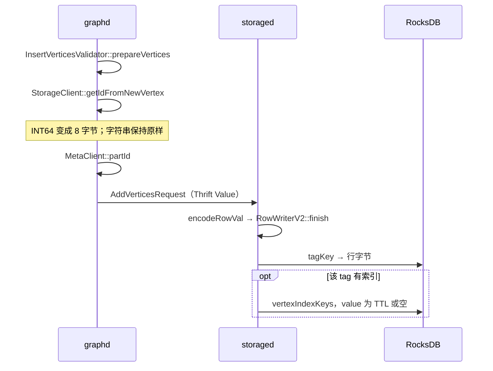

# 09 — 从一条语句看编码，以及建模时要注意什么

> 把 [06](06-key-encoding.md)、[07](07-row-encoding.md)、[08](08-index-key-encoding.md) 串到 INSERT、FETCH、GO、LOOKUP、ALTER 上。
> 存储侧 filter / limit 的执行不在这里重复，见 [04-storage-execution](04-storage-execution.md)。
> 源码基线：master `426266b5`，差异处对照 `v3.8.0`。
> 分析日期：2026-10-26

---

## 0. 两条通道

图上的属性和 RocksDB 里的字节不是同一种编码。

| 阶段 | 编码 | 代码 |
|------|------|------|
| graphd 内存 | `nebula::Value` / `DataSet` | `src/common/datatypes/Value.h`，`DataSet.h` |
| graphd ↔ storaged | Thrift。`common.thrift` 的 `union Value` 标了 `cpp.type = "nebula::Value"` | `NewVertex`、`NewEdge`、`GetNeighborsResponse`、`GetPropResponse`、`LookupIndexResp` |
| storaged ↔ RocksDB | `NebulaKeyUtils` + `RowWriterV2` | `AddVerticesProcessor`、`AddEdgesProcessor` |

`Value` 的类型是位标志：`INT = 1<<2`，`STRING = 1<<4`，`LIST = 1<<11`，`GEOGRAPHY = 1<<15`，`NULLVALUE = 1<<63`。Thrift union 的字段是 `nVal`、`bVal`、`iVal`、`fVal`、`sVal`、日期、`Vertex`、`Edge`、`Path`、`NList`、`NMap`、`NSet`、`DataSet`、`Geography`、`Duration`。线上传的是这棵 union，不是行格式的字节。

`DataSet` 是 `column_names` 加 `list<Row>`，`Row` 是 `list<Value>`。`GetNeighborsResponse` 的注释把一行画成：

```
| _vid | stats | tag 列... | edge 列... | expr 列 |
```

tag 列是 `list<Value>`，edge 列是 `list<list<Value>>`。storaged 在 `GetNeighborsNode` 里把属性从 `RowReaderV2` 读成 `Value` 再装进这个 `DataSet`。graphd 看不到 null bitmap，也看不到 schema version 字节。

过滤表达式是第三条旁路：`Expression::encode` 进请求，storaged `Expression::decode` 后在 `FilterNode` 里对已经解码的 `Value` 求值。细节在 [04](04-storage-execution.md)。

---

## 1. INSERT VERTEX



1. `InsertVerticesValidator::prepareVertices` 检查 VID 类型和列数，属性求值成 `vector<Value>`，放进 `NewTag.props`。没写的 nullable 列、默认值不在 graphd 填完；storaged 的 `RowWriterV2::finish` 会补。边的插入路径在 `InsertEdgesValidator` 里会把缺省列先算好，点和边不完全一样。
2. `InsertVerticesExecutor` 调用 `StorageClient::addVertices`。`getIdFromNewVertex` 把整数 VID 收成 8 字节字符串，`partId` 用它取模。请求按 part 分组。
3. `AddVerticesProcessor::doProcess`（无索引）或 `doProcessWithIndex`：`tagKey(spaceVidLen, partId, vid, tagId)`，`encodeRowVal`。`ifNotExists` 时先 `findOldValue`，已有值则跳过。
4. 有索引时在同一个 atomic op 里：删旧索引项、写新索引项、写 tag。TTL 列可读时，索引 value 是 `IndexKeyUtils::indexVal`。索引正在重建则改写 `OperationKeyUtils` 的操作 key。

`FLAGS_use_vertex_key` 默认 false。打开时同一批里还会写一条空 value 的 `vertexKey`。

---

## 2. INSERT EDGE

`InsertEdgesValidator::prepareEdges` 对每一行生成两条 `NewEdge`：

- 正向：`src`、`dst`、`edge_type`、`rank`，属性是一份。
- 反向：src/dst 对调，`edge_type` 取负，属性再放一份。`ranking` 不变。

`StorageClient::getIdFromNewEdge` 同样把整数端点收成 8 字节。分区按这条边的 src 计算，所以正向和反向通常在不同 part，两次 RPC。

`AddEdgesProcessor` 对每条 `EdgeKey` 调用 `edgeKey`，value 仍是 `encodeRowVal`。反向边是独立的一行，schema 用 `abs(edge_type)` 找。rank 在 key 里经过 `encodeRank`，不在 value 里再存一份。

`IsolationLevel::TOSS` 时 `toPlan` 会把 `useChainInsert` 设为 true——但在 **v3.8.0 里这个标记没有读者**：`useChainInsert()` 零调用者，`InsertEdgesExecutor` 硬编码 `useExperimentalFeature=false`（`InsertExecutor.cpp:58`），所以 INSERT EDGE 实际仍走 `future_addEdges`，**不会**改走 chain processor，也不会写 `ConsistUtil::primeKey` / `doublePrime`。key 的形状见 [06](06-key-encoding.md)。默认隔离级别不是 TOSS。

---

## 3. FETCH 与 GO 怎么读回来

FETCH 走 `getProps`。顶点/标签行由 `GetPropNode` 经 `tagKey` 取 value；边属性另走 `FetchEdgeNode` / `edgeKey`（`GetPropProcessor.cpp:247-252`），`RowReaderWrapper::getTagPropReader` 按行内 schema version 选历史 schema，`QueryUtils::readValue` 解出 `Value`。TTL 过期的 tag 被跳过。整数 VID 在结果第一列被还原成 `int64`（`GetPropNode` 与 `GetNeighborsNode` 同一写法）。

GO 的一跳在存储侧是 `GetNeighbors`。`GetNeighborsNode::doExecute`：

- 第一列：整数空间读 8 字节成 `int64`，字符串空间用请求里的 VID 字符串。
- 后面每个 tag 列、edge 列是已经解码的 `Value` 列表。
- 边来自 `edgePrefix`。出边和入边是不同的 `EdgeType` 前缀；优化器把谓词放进 `filter` 之后，storaged 才在这些边上求值。求值过程见 [04](04-storage-execution.md)。

返回的 `DataSet` 里没有行字节。schema 演进对 graphd 是透明的：旧行缺的新列已经在 storaged 被默认值或 NULL 填上。填不上时（非空且无默认）`readValue` 报错，而不是返回空行。

---

## 4. 索引扫描

LOOKUP 在 storaged 是 `LookupProcessor` → `IndexVertexScanNode` / `IndexEdgeScanNode`（`IndexScanNode` 的两个子类，`LookupProcessor.cpp:189-208`）。

1. `indexPrefix(partId, indexId)` 加上谓词能确定的列前缀。列的编码规则见 [08](08-index-key-encoding.md)。字符串只用索引长度那一段，后面的原文不在 key 里。
2. 地理列是多条 S2 cell 前缀，key 里没有原始 Geography。
3. `checkTTL` 看索引 value。过期则跳过。value 为空表示写入时没有 TTL 列。
4. 命中的 VID（或 src/rank/dst）再回到数据 key 取行。索引 key 解不出地理值，`decodeValue` 对 `GEOGRAPHY` 返回 `kNullBadData`。

建索引时 `collectIndexValues` 用写入那一行的 reader；列在旧 schema 里不存在时，`readValueWithLatestSche` 用最新 schema 的默认值。这和查询补列是同一规则。

---

## 5. ALTER

`AlterTagProcessor`：`newVersion = latestVersion + 1`，新 schema 写到新的 `__tags__` key。数据 part 上的 tag key 和行字节都不变。

之后的 INSERT 用最新 schema，行头带新 version。之前的行仍带旧 version。读路径按第 [07](07-row-encoding.md) 节选择历史 schema，再补新列。

已有索引时，这次 ALTER 若试图设一个有效的 TTL（列名非空且 duration > 0），直接 `E_UNSUPPORTED`。索引和 TTL 同时存在时，索引 value 里那份时间戳不会在这次 ALTER 里被回填；回填发生在重建索引或之后的写入。源码里没有「ALTER 时扫描全部数据行改 TTL」的路径。

---

## 6. 建模和使用

这些是上面字节布局的直接后果。

**VID 类型。** `INT64` 在 key 里是 8 字节主机序整数，分区是这个整数对 part 数取模再加 1。连续整数会按取模散开，但同一个整数的所有 tag 和出边都在同一个 part。`FIXED_STRING` 不足 `vid_len` 时用 `'\0'` 补齐，前缀扫描按补齐后的字节序，不按数值。`vid_len == 8` 的字符串会走 `MetaClient::partId` 的整数分支，分区不是 MurmurHash。字符串 VID 里不要放 `'\0'`，读取在第一个 `'\0'` 截断。

**热点点。** 一个 src 的出边是同一条 `edgePrefix`。超级点是单 part 上的一段很长的 key 范围，`GO` 要从这里扫出来再过滤。入边不在这个 part，它以对端为 src、type 为负，写在对端的 part。把「高扇出」和「高扇入」看成两段前缀，而不是同一段。

**rank。** 只有 rank 在边 key 里按数值有序。用 rank 表示时间或版本时，同一对 src/type 下的范围扫描是有序的。EdgeType 本身是主机序，不要假设 type 10 和 type 11 的 key 相邻。

**大属性。** STRING、GEOGRAPHY、LIST/SET 的正文在行尾。行 value 变大，点查和超级点扫描都要读这些字节。索引不会自动带上全文：`STRING` 索引最长 256，key 里只有这个前缀，超长被截断。`FIXED_STRING` 索引用 schema 全长，`CreateTagIndexProcessor` 没有再卡 256；给很长的 `FIXED_STRING` 建索引会让索引 key 一样长。LIST/SET 在 master 上不能建索引，整数元素按 int32 存储，float 元素按 4 字节 float 存储。

**NULL 与边界值。** 索引里 null 是一串 `0xFF` 加位图。`INT64_MAX` 和 double NaN 的列字节也是一串 `0xFF`，和 null 的差别只在 VID 前面的那 2 字节位图。范围扫描若把上界设到类型的最大编码，需要把这个位图算进去；`IndexScanNode` 已经按 `encodeValue` 生成边界，业务侧不要自己拼字节。

**TTL。** 列必须是 `INT64` 或 `TIMESTAMP`。默认按秒比较，`FLAGS_ttl_use_ms` 才按毫秒。NULL 不过期。过期行仍然占着 key，直到读路径跳过或 compaction 滤掉。索引里的 TTL 是写入时复制的那一列，和行尾 `finish()` 的微秒时间戳不是同一个数。

**schema 演进。** 加列不必回填旧行，前提是新列有默认值或允许 NULL。非空且无默认的新列，读旧行会失败。改完 schema 再读，走的是行内 version，不是「用最新偏移硬解旧 value」。
