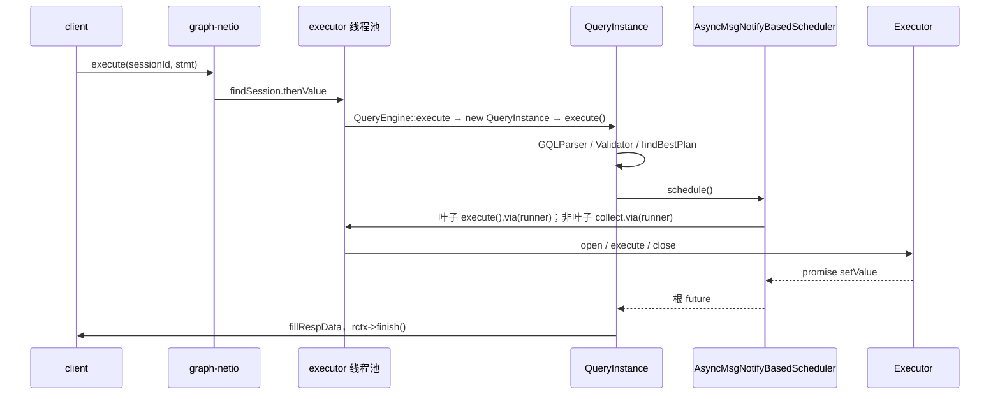
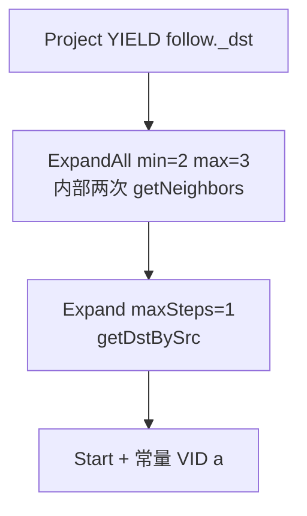
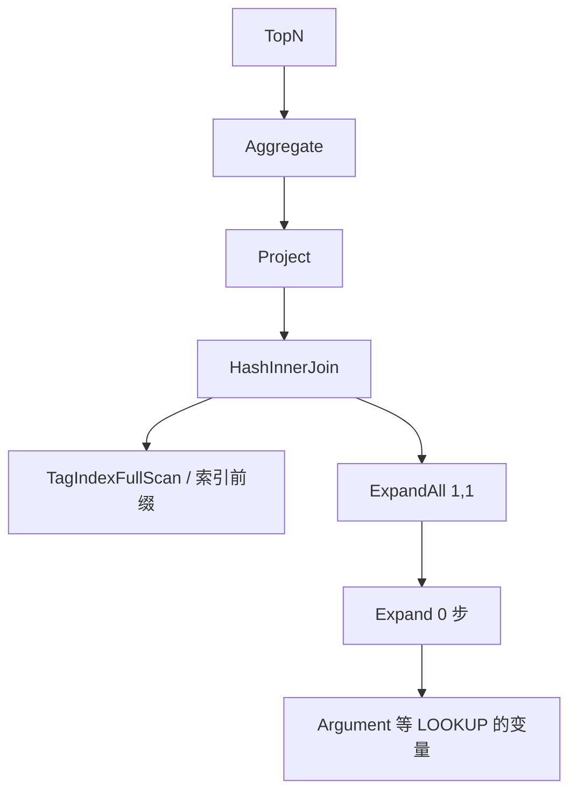
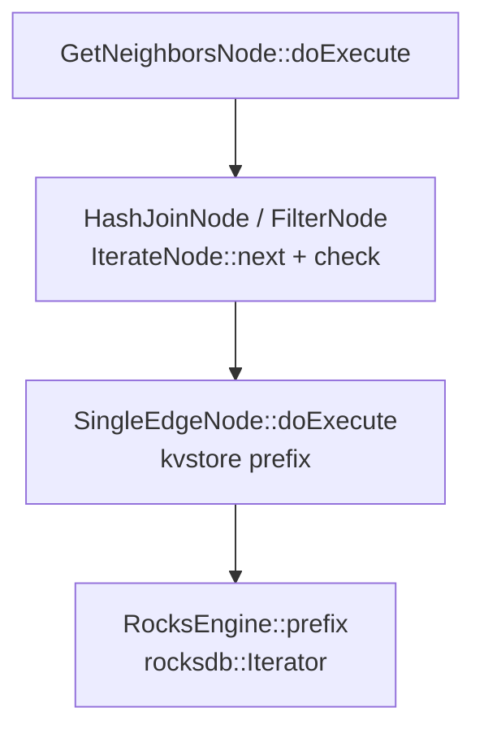

# 13 — 控制流：graphd 怎么调度，GO 是什么计划

> 源码：<https://github.com/vesoft-inc/nebula>
> 主对照 tag `v3.8.0` `fa928930ab34f150db522933323aa610e54f26e7`（2024-05-17）
> 系列基线 master `426266b5c3df856d27f747b55b916dec542b7b59`（2026-09-08）
> 对照方式：浅克隆 `v3.8.0` 的 `src/`，再 `git diff --stat fa928930 426266b5`。
> 本文引用的 `src/graph/scheduler/`、`src/graph/context/`、`src/graph/validator/GoValidator.cpp`、`src/graph/planner/ngql/GoPlanner.cpp`、`src/graph/executor/query/Expand*.cpp`、`src/graph/executor/query/TraverseExecutor.*`、`src/storage/exec/RelNode.h`、`src/storage/exec/IndexNode.h` 在这两份树上没有差异。
> master 相对 3.8 改过的、和查询执行挨着的文件是 `GetNeighborsProcessor.cpp` 的 limit 裁剪（见 [04](04-storage-execution.md)）、`UpdateExecutor`、`MatchSolver`、`NebulaStore` 快照。它们不改变本文的调度模型和 GO 计划形状。
> 优化器入口不在这里展开，见 [01](01-optimizer-framework.md)。算子上的 filter 如何进 RPC，见 [04](04-storage-execution.md)。变量里的字节和 Iterator 怎么游走，见 [14](14-data-flow.md)。
> 计划形状是从 planner / executor 源码串出来的，不是一份 EXPLAIN 日志。和 [11](11-scenario2-beauty-buyers.md) 同一限制。场景二那三条在 [12](12-scenario2-bench.md) 里有 PROFILE 行数；列和字节在 [20](20-intermediate-representation.md)。
> 分析日期：2026-10-26

---

## 0. 概述

一条 nGQL 在 graphd 上是一次请求、一棵 `PlanNode` 树、一组 `Executor`。调度器用 folly future 按依赖把算子跑起来。每个算子的 `execute()` 结束后，把整份结果放进 `ExecutionContext` 的一个变量。下游算子再从这个变量读。

本文回答四件事：

1. graphd 的执行模型是什么，和 Volcano、push、向量化各差在哪。`v3.8.0` 和 master `426266b5` 有没有向量化或算子间流水线。
2. 请求从 `GraphService` 到 `AsyncMsgNotifyBasedScheduler` 的控制流，线程各在哪。
3. `Select` / `Loop` / `PassThrough` / `Argument` 谁在用。多步 GO 的循环在哪。
4. GO 从语法到 `GoValidator` / `GoPlanner` 的计划，和 MATCH 的 `Traverse` 怎么分。

### 和其他篇的关系

| 文章 | 关系 |
|------|------|
| [01-optimizer-framework](01-optimizer-framework.md) | `QueryEngine` 组装 RuleSet，`findBestPlan` 的位置。本文从它前后把整条控制流补上 |
| [04-storage-execution](04-storage-execution.md) | filter / limit 进 `GetNeighbors` 之后，storaged 的 `FilterNode` 怎么挂。本文只写谁调用谁 |
| [09-write-read-chain](09-write-read-chain.md) | 行字节和 Thrift `Value`。本文的写路径只到 Raft append |
| [11-scenario2-beauty-buyers](11-scenario2-beauty-buyers.md) | `LOOKUP \| GO` 的算子形状和下推结论。本文用同一条语句走调度 |
| [14-data-flow](14-data-flow.md) | 变量、`Result`、`Iterator`、RPC 合并、何时拷贝 |

---

## 1. graphd 的执行模型

判断：graphd 是**按算子整批物化、由依赖上的 future 推动**的模型。`Iterator` 是已经放进变量的结果上的游标，父算子不会通过 `next()` 把子算子拉起来。storaged 读邻居和读索引的内层循环更接近 Volcano：`IterateNode` 的头注释写了 “typical volcano node”，`IndexNode::next()` 一次交出一行。

四套模型和源码里的落点：

| | 父节点怎么拿到下一行 | 算子边界 | Nebula 3.8 / master `426266b5` 里谁是这样 |
|--|----------------------|----------|------------------------------------------|
| Volcano（pull，一次一条或一小批） | 父算子循环调用子算子 `next()` | 中间结果可以不落地成完整变量 | storaged `IterateNode::next`、`IndexNode::next`。graphd 的 `Executor` 没有 `next()` |
| Push / pipeline | 子算子产出一行就交给父算子 | 上下游可以同时处于「正在产出 / 正在消费」 | graphd 没有这条通道。下游在 `folly::collect` 看到依赖全部成功之后才 `execute()` |
| 向量化 | 一次处理一块列式 batch，通常配 SIMD | 物化单位是向量，不是一行 `Value` | `DataSet` 是 `vector<Row>`，`Row` 是 `vector<Value>`。`src/` 里没有 SIMD / columnar kernel。`IndexNode::next` 的注释写了可以做 batch，当前一次返回一行 |
| 按算子物化 | 一个算子跑完，整份 `Result` 写入命名变量 | 每个算子都是屏障 | graphd `Executor::execute` → `finish` → `ExecutionContext::setResult` |

`Executor` 的三个阶段是 `open` / `execute` / `close`（`src/graph/executor/Executor.h`）。`execute()` 返回 `folly::Future<Status>`，成功后 `close()`，再 `notifyOK` 把依赖它的 promise 设上。没有「再给我下一行」的接口。

`Iterator` 的 `valid` / `next` / `row`（`src/graph/context/iterator/Iterator.h`）看起来像 Volcano 的算子接口。它的 `value_` 是构造时传进来的 `shared_ptr<Value>`。`SequentialIter` 把游标放在这份 `DataSet` 的 `rows` 上（`SequentialIter.cpp` 构造函数）。游标往前走不会调用另一个 `Executor`。四种 kind 和谁创建它们，见 [14](14-data-flow.md)。

### 1.1 算子之间没有流水线

`AsyncMsgNotifyBasedScheduler::runExecutor`：

```cpp
// src/graph/scheduler/AsyncMsgNotifyBasedScheduler.cpp
return folly::collect(futures).via(runner).thenValue(
    [exe, this](auto&& t) mutable -> folly::Future<Status> {
      NG_RETURN_IF_ERROR(checkStatus(std::move(t)));
      return execute(exe);
    });
```

`folly::collect` 要等这个算子登记的每一份 future 都完成。`checkStatus` 有一份失败就整段返回。然后才 `execute`。下游开始时，上游的 `finish` 已经把结果放进变量。

叶子走另一条：`runLeafExecutor` 是 `execute(exe).via(runner)`，先在当前线程进入 `execute()`，返回的 future 再切到 worker。存储 RPC 的 future 链在算子内部继续，调度器仍然把整个算子看成一份 future。

`ExpandAllExecutor` / `TraverseExecutor` 内部会在一步 RPC 处理完之后再调 `getNeighbors()`。那是**同一个 Executor 里的步循环**，下一步仍然等这一步的 `handleResponse` 结束。步与步之间是屏障，算子与算子之间也是屏障。

### 1.2 算子内部的并行，默认基本关着

这些是「把已经在手的行切开」，不是上下游流水线。

| 开关 | 默认 | 谁用 | 切的是什么 |
|------|------|------|------------|
| `FLAGS_max_job_size` | `1`（`GraphFlags.cpp`） | `Executor::runMultiJobs`。`FilterExecutor`、`ProjectExecutor`、`HashInnerJoin` / `HashLeftJoin`、`AppendVerticesExecutor`、`TraverseExecutor::buildPathMultiJobs` | 输入 `Iterator` 上的 `[begin, end)`。`getBatchSize` 用 `max(min_batch_size, ceil(totalSize / max_job_size))`，`min_batch_size` 默认 8192。`max_job_size == 1` 时 `FilterExecutor` 直接走单线程 `handleSingleJobFilter` |
| `FLAGS_num_operator_threads` | `2` | 只在 `BFSShortestPathExecutor`、`MultiShortestPathExecutor` 里用来除路径条数 | 最短路拼路径。GO / MATCH 的 `Expand*`、`TraverseExecutor` 不读这个 flag |
| `FLAGS_query_concurrently` | `false`（`StorageFlags.cpp`） | `GetNeighborsProcessor`、`GetPropProcessor`、`GetDstBySrcProcessor`、`Scan*Processor`、`LookupProcessor` | storaged 上每个 part 一份 future，做完再 `append` 到同一个 `DataSet` |

`FilterExecutor` 对 `GetNeighborsIter` 还有一句注释：这个迭代器不是线程安全的，所以即使 `max_job_size > 1` 也强制单线程。`runMultiJobs` 的 scatter 会 `iter->copy()`，再在 worker 上 `next()`。输入必须已经有 `size()`，也就是已经物化。

`TraverseExecutor::buildResult` 在步循环结束之后才拼 path。`max_job_size <= 1` 时对每个起点串行 `buildPath`；大于 1 才 `buildPathMultiJobs`。扩展本身不因此变成流水线。

`GetDstBySrcProcessor::onProcessFinished` 在返回前对**这一台 storaged 上已经扫完的 dst** 做去重。行数小于 `FLAGS_concurrent_dedup_threshold * 2`（阈值默认 5000 万，所以界线是 1 亿行）时单线程 `unordered_flat_set`。超过之后按 `nRows / threshold` 分片，线程数不超过 `FLAGS_max_dedup_threads`（默认 6），分片插入并行，再串行并回同一个 set。这是响应发出前的去重，不是 graphd 算子流水线。跨 host 的重复 dst 仍各回一次。

### 1.3 storaged 里谁是 Volcano

`RelNode::doExecute` 先对每个依赖调用 `execute`，依赖全部返回之后自己才继续（`src/storage/exec/RelNode.h`）。这和 graphd 一样，是「依赖跑完再跑自己」，单位是一次 `execute(partId, vId)`，不是一行。

`IterateNode` 在这之上另有一套 `next()`：

```cpp
// src/storage/exec/RelNode.h
// IterateNode is a typical volcano node, it will have a upstream node. It keeps
// moving forward the iterator by calling `next`. If you need to filter some data,
// implement the `check` just like FilterNode.
void next() override {
  do {
    upstream_->next();
  } while (upstream_->valid() && !check());
}
```

`GetNeighborsNode::iterateEdges` 对 `upstream_->valid()` / `next()` 做 for 循环，把通过的边收进当前顶点那一行的 `List`，最后 `resultDataSet_->rows.emplace_back`。RPC 回到 graphd 时，这个顶点的邻居已经是一份 `DataSet`。Volcano 停在 storaged 进程内、一个顶点的边扫描上。

索引是另一套类，不继承 `RelNode`。`IndexNode` 的类注释把执行分成 `execute(partId)` 初始化、然后 `next()` 迭代。`IndexNode::Result` 三种状态：出错、成功但没有剩余行、成功且有一行 `Row`。`next()` 的注释写：

> Row format has been determined during `init()`. Batch processing and loop unrolling can be used to optimize performance if necessary, but there are no serious performance problems at present.

`IndexSelectionNode` 里还有一行 TODO：`ExprContext could be moved out later if we unify the volcano in go/lookup`。作者把 GO 那条 `IterateNode` 和 Lookup 的 `IndexNode::next` 都叫 volcano，并注明两边还没合成一套。当前 `doNext()` 一次过滤一行。

`StoragePlan` 的类注释要求调用方保证无环，并且「两个节点依赖同一个节点时，那个节点会被执行多次」。这是拉模式的副作用，不是共享的流水线节点。

### 1.4 3.8 和 master 有没有向量化或流水线

在 `426266b5` 相对 `fa928930` 的 diff 里，上面这些调度、`Iterator`、`RelNode`、`IndexNode`、`ExpandAll`、`GoPlanner` 文件都不在变更列表中。没有新增的列式执行器，也没有把 `finish` / `setResult` 改成按批推给下游的接口。

已有的「分批」都在 3.8 就已经在，master `426266b5` 没有再加一种执行模型：

- graphd `runMultiJobs` 的行区间，默认 `max_job_size = 1`。
- 最短路用 `num_operator_threads` 切路径条数。
- storaged `query_concurrently` 按 part 并行，默认 false。
- `GetDstBySrcProcessor` 在 dst 行数达到约 1 亿后，用最多 6 个线程分片去重，再串行合并。

---

## 2. 请求入口和线程



`GraphServer::start`（`src/graph/service/GraphServer.cpp`）建两个池：

| 池 | 代码 | 规模 | 做什么 |
|----|------|------|--------|
| `graph-netio` | `folly::IOThreadPoolExecutor`，`FLAGS_num_netio_threads`，0 表示物理核数 | Thrift 的 IO 池。`StorageClient` 的 `getResponse` 用 `ioThreadPool_->getEventBase()` 发 RPC |
| `executor` | `PriorityThreadManager`，线程数是 `FLAGS_num_worker_threads`，0 则用 Thrift IO worker 数 | `GraphService` 把 `getThreadManager()` 放进 `RequestContext::setRunner`。调度器和算子的 `runner()` 就是它 |
| `graph-memory-monitor` | `QueryEngine::setupMemoryMonitorThread` | 一个 `GenericWorker`。默认每 `check_memory_interval_in_secs`（1 秒）调 `MemoryUtils::hitsHighWatermark` |

`GraphService::future_execute` 转到 `future_executeWithParameter`。`sessionId == 0` 直接 `E_SESSION_INVALID`。否则 `sessionManager_->findSession(...).thenValue(...)`：回调里 `queryEngine_->execute(ctx)`。`QueryEngine::execute` `new QueryInstance` 并调用 `execute()`。`QueryInstance` 在 `onFinish` / `onError` 里 `delete this`。成功路径会先 `scheduler_->waitFinish()`，等 `executing_` 归零；失败路径没有这句等待。类注释写的前提是：删掉之后不再有未完成的异步任务碰这些资源。

`kNumActiveQueries` 在 `findSession` 的回调里，`execute()` 返回后立刻 `decValue`。`execute()` 本身不等调度 future。这个计数覆盖的是「提交进 `QueryInstance::execute`」这段，不是整次查询的墙钟时间。

会话对象是 `ClientSession`。`QueryInstance` 构造时 `session()->addQuery(qctx)`，结束时 `deleteQuery`。`USE` 之后的 space 在 session 上，`Validator::validate` 开头 `switchToSpace`。认证在 `future_authenticate`：`FLAGS_enable_authorize` 为 false 则跳过；否则按 `FLAGS_auth_type` 走 `PasswordAuthenticator` 或先密码再 `CloudAuthenticator`。

`QueryContext`（`src/graph/context/QueryContext.h`）的注释写明：生命周期等于这次请求，parser、planner、optimizer、executor 都看得到；**不是线程安全的**，计划必须保证对它的访问安全。它持有 `ValidateContext`、`ExecutionContext`、`ExecutionPlan`、`ObjectPool`、`SymbolTable`，以及进程级的 `SchemaManager`、`IndexManager`、`StorageClient`、`MetaClient` 指针。`ObjectPool` 里放表达式、`PlanNode`、`Executor`。

---

## 3. parser → validator → planner → optimizer → scheduler

`QueryInstance::validateAndOptimize` 的顺序是固定的：

```cpp
// src/graph/service/QueryInstance.cpp
auto result = GQLParser(qctx()).parse(rctx->query());
sentence_ = std::move(result).value();
NG_RETURN_IF_ERROR(Validator::validate(sentence_.get(), qctx()));
if (auto status = findBestPlan(); !status.ok()) {
  return Status::Error("Error found in optimization stage: %s", ...);
}
```

| 阶段 | 入口 | 产出 |
|------|------|------|
| Parser | `GQLParser::parse`，文法在 `src/parser/parser.yy` | `Sentence`。多语句是 `SequentialSentences` |
| Validator | `Validator::validate` → `makeValidator` → `validate()` | 语义检查、`AstContext`，然后 `Validator::toPlan` → `Planner::toPlan`。根写进 `qctx->plan()->setRoot` |
| Planner | `PlannersRegister::registerPlanners`，`QueryEngine::init` 调一次。GO 注册在 `Sentence::Kind::kGo` → `GoPlanner`；MATCH 是 `MatchPlanner` | `SubPlan` 的 root / tail |
| Optimizer | `QueryInstance::findBestPlan` → `Optimizer::findBestPlan` | 改 root。规则和 `PrunePropertiesVisitor` 见 [01](01-optimizer-framework.md) |
| Scheduler | `explainOrContinue` 为真才 `scheduler_->schedule()` | `Executor` 图和 future |

`EXPLAIN` 不是 `PROFILE` 时，`explainOrContinue` 填 `planDesc` 后返回 false，`onFinish` 直接结束，不调度。`PROFILE` 返回 true，照常执行，`Executor::close` 把 `ProfilingStats` 加进 `ExecutionPlan`。

优化失败被包成 `"Error found in optimization stage: ..."`，注释说不把优化器原文直接当作用户错误。

---

## 4. ExecutionPlan 和 AsyncMsgNotifyBasedScheduler

`ExecutionPlan` 的头注释写 “Directed Cyclic Graph which composed by PlanNodes”。依赖指针本身按下面的 BFS 展开。`Loop::body()` 不在 `dependencies()` 里，`Select` 的 then / else 也不在。环在运行时：`runLoop` 条件为真就再 `doSchedule(body)`，body 里的 `Argument` 去等变量的 `writtenBy`。`src/graph/planner` 下没有从 body 再指回 `Loop` 节点的 `addDep`。存储侧的 `StoragePlan` 注释则要求无环。

`schedule()` 在 `FLAGS_enable_lifetime_optimize`（定义在 `Executor.cpp`，默认 true）时先 `analyzeLifetime`：沿依赖给每个输入变量的 `userCount` 加一；`Select` / `Loop` 的输出变量被写成 `uint64` 最大值，避免被提前丢掉；`Loop` 的 body 带着更大的 `loopLayers`。根的 `userCount` 也写成最大值，因为最后 `fillRespData` 还要读它。释放规则见 [14](14-data-flow.md)。

然后 `Executor::create` 从根递归 `makeExecutor`。`Select` 额外 `setThenBody` / `setElseBody`，`Loop` 额外 `setLoopBody`。普通依赖用 `dependsOn`。同一个 `PlanNode::id` 只建一个 `Executor`（`visited` map）。

`doSchedule` 从根做 BFS，方向是依赖（叶子在后）。每个节点准备：

- 一份自己的 promise 列表：谁依赖我，谁就在我的 `promiseMap` 里放一个 promise。根额外有一份，它的 future 就是 `schedule()` 的返回值。
- 一份自己要等的 future 列表：普通节点等 `depends()`；`Argument` 不等 `depends()`，改等 `inputVar` 的 `writtenBy` 里每个 `PlanNode`。

第二趟按同样的顺序对每个 Executor 调 `scheduleExecutor`。promise 在依赖完成时 `notifyOK` / `notifyError`。`setValue` 唤醒 `folly::collect`。

`execute()` 的顺序：`open`（查 `qctx_->isKilled()`、查询节点再查内存水位）→ `runExecute`（`addExecuting`，若已有失败状态就直接返回那份状态，否则在 `MemoryCheckGuard` 里调 `executor->execute()`）→ 成功则 `close` 并 `removeExecuting`。`bad_alloc` 收成 `Status::GraphMemoryExceeded`。`executing_ == 0` 时 `waitFinish` 的条件变量被唤醒。

失败：`setFailStatus` 只记第一份。已经进了 `execute()` 的算子会跑完自己的 future；还没开始的在 `runExecute` 开头看到 `failedStatus_` 就返回，不再进算子。

---

## 5. Select、Loop、PassThrough、Argument

| 节点 | 调度 | `v3.8.0` 里谁构造 |
|------|------|-------------------|
| `Select` | `runSelect`：先 `execute` 条件，读输出变量，必须是 bool。真走 `doSchedule(thenBody)`，假走 `elseBody`。另一支本轮不调度 | `Select::make` 只出现在 `Select::clone` 和 `executor/test/LogicExecutorsTest.cpp`。`src/graph/planner` 下没有语句调用它。调度器、`Executor::makeExecutor`、`analyzeLifetime`、`OptGroup` 都准备了 then/else。当前这棵树的生产计划不会出现 Select |
| `Loop` | `runLoop`：执行条件，输出必须是 bool。`LoopExecutor` 把 NULL 条件当成 true。false 则本轮结束。true 则 `doSchedule(body)`，完成后再调 `runLoop` | 只有 `PathPlanner`（最短路的单对和多对）。GO、MATCH、`SubgraphPlanner` 都不调用 `Loop::make` |
| `PassThrough` | 普通节点。`PassThroughExecutor` 发现输出变量上的迭代器不是默认迭代器且非空，就直接 `Status::OK`；否则 `finish` 一个只有列名的空 `DataSet` | `GoPlanner` 的 0 步；`PathPlanner` 把两侧 `GetNeighbors` 接到同一个点上；`VertexIdSeek` |
| `Argument` | 不把 `depends()` 放进 future。等 `inputVar` 的 `writtenBy`。执行时从那份结果里取出别名列，去重，写成单列 `DataSet` | `GoPlanner` 的运行时起点、`buildJoinDstPlan` 的终点 VID、`LookupPlanner` |

`PipeValidator::toPlan`：右支的 tail 若是 `Argument` 或 `Start`，不再把左支 `dependsOn` 到右支上。两边只通过变量名接上，调度器靠 `writtenBy` 补这根等待边。tail 是普通单输入节点时，才 `appendPlan` 并把空的 `inputVar` 设成左支 root 的 `outputVar`。

0 步 GO 走 `PassThrough`，见下一节。最短路的 `Loop` 每轮重跑 body 里的 `GetNeighbors` + BFS 算子，条件由 `PathPlanner::singlePairLoopCondition` 那类表达式写在 `Loop` 上。那是调度器级的循环。GO 的多步不是这条路径。

---

## 6. GO 是什么

GO 是 nGQL 的邻接扩展语句：从一组起点，沿 `OVER` 列出的边，走固定步数或一个闭区间，再 `YIELD` 边、起点、终点上的属性。它不构造 MATCH 那种 path。步与步之间的中间顶点默认不作为最终行交出来，除非步数区间把它们包含进去。

### 6.1 语法

`src/parser/parser.yy`：

```
go_sentence
    : KW_GO step_clause from_clause over_clause where_clause yield_clause truncate_clause

step_clause
    : %empty                          -- StepClause()，1 步
    | legal_integer KW_STEPS          -- N 步
    | legal_integer KW_TO legal_integer KW_STEPS   -- M TO N

from_clause
    : KW_FROM vid_list                -- 字面量
    | KW_FROM vid_ref_expression      -- $-.列 或 $var，文法拒绝表达式里的参数

truncate_clause
    : KW_SAMPLE expression            -- 表达式必须是 LIST，长度等于步数
    | KW_LIMIT expression             -- 同上，语义是每步的限额
```

`YIELD` 不能省。`GoValidator::validateYield` 在 `yield == nullptr` 时返回 `Missing yield clause.`

### 6.2 语义检查

`GoValidator::validateImpl`：

1. `ValidateUtil::validateStep` 填 `goCtx_->steps`。
2. `validateStarts` 区分字面量 VID、管道 `$−`、命名变量。
3. `validateOver` 填边类型和方向。
4. `validateWhere`：`checkDstPropOrVertexExist` 看到 `$$` 或 `kDstProperty` 就把 `joinDst` 设上；`VERTEX` 这个名字直接语义错误。然后 `rewriteLabelAttr2EdgeProp`、常量折叠、类型必须是 bool / null / empty。属性收进 `exprProps`。
5. `validateYield`：`id($$)`、`id($^)`、`rank(edge)`、`typeid(edge)` 改写成边的 dst / src / rank / type。`distinct` 来自 `YIELD DISTINCT`。
6. `validateTruncate`：SAMPLE 或 LIMIT 的列表长度必须等于 `nSteps`（M TO N 用 N），元素是非负整数，放进 `goCtx_->limits`。
7. `$-` 只能在 `FROM` 已经是管道时出现在 WHERE / YIELD。命名变量同样必须先出现在 `FROM`。整句只允许一个输入。
8. `isSimpleCase()`，然后 `buildColumns()`：把 WHERE 和 YIELD 里的属性抽成 `srcPropsExpr` / `edgePropsExpr` / `dstPropsExpr`，原表达式改写成 `VariableProperty`，留给后面的 `Project` / `Filter`。

`isSimpleCase` 同时满足才为真：

- 没有 SAMPLE / LIMIT，有 `DISTINCT`，没有 WHERE
- 没有起点 tag、没有终点 tag
- 边属性若出现，只能是 `_dst`
- YIELD 的每一列 kind 都是 `kEdgeDst`，并且要么写成 `*`，要么 `OVER` 只有一种边

有 WHERE 就不是 simple。场景二那条带 `buy.ts` 和 `amount` 的语句因此走 `doPlan`，见 [11](11-scenario2-beauty-buyers.md)。`id($$)` 在 `isSimpleCase` 执行前已经被改成 `kEdgeDst`；`dst(edge)` 这个函数调用不会被改写，kind 对不上，也不是 simple。

### 6.3 计划：GoPlanner

`GoPlanner::transform`：

| 条件 | 计划 |
|------|------|
| 步数不是 M TO N，且 `steps() == 0` | 一个 `PassThrough`，列名是 YIELD 的列。不建 `Expand` |
| `isSimple` | `doSimplePlan` |
| 其他 | `doPlan` |

起点：

- 字面量 VID：`PlannerUtil::buildConstantInput` 放进 `vidsVar`，tail 是 `StartNode`。
- 管道或变量，且 simple：不再建 `Argument`。`startNode_` 直接是上一句的 root，`vidsVar` 是那个变量名。注释里的例子是 `GO ... YIELD DISTINCT edge._dst AS id | GO FROM $-.id ... YIELD DISTINCT edge._dst`。
- 管道或变量，且不 simple：`Argument(runtimeVidName)`，`setInputVertexRequired(false)`，`vidsVar` 是 Argument 的输出变量。`joinInput` 在 `fromType != kInstantExpr` 时为真。

`doPlan` 的两段扩展，注释写在 `ExpandAllExecutor.h`：

- `Expand` 负责「不带用户要的属性」的前缀步。步数是 `minStep == 0 ? 0 : minStep - 1`。0 步时 `ExpandExecutor` 不发 RPC，把输入 VID 原样写成一列（`joinInput` 时两列，第二列也是这个 VID）。大于 0 且不需要和上一句按 VID 对齐、也没有每步 LIMIT 时，走 `getDstBySrc`，输出去重后的 dst。需要 `joinInput` 或有 `stepLimits` 时改走 `getNeighbors`，保留起点到当前 dst 的对应。
- `ExpandAll` 从这条边界接着走，带上 `edgeProps` / `vertexProps`。`minSteps` / `maxSteps` 用语句的 M、N。

`getNeighbors` 的方向参数在 `ExpandExecutor` / `ExpandAllExecutor` 里写死 `OUT_EDGE`。`getDstBySrc` 没有方向参数，边类型来自 `buildEdgeTypes` / `buildEdgeProps`，`REVERSELY` 时把 `EdgeType` 取负。这和 [11](11-scenario2-beauty-buyers.md) 对 `REVERSELY` 的结论同一处。

`joinDst` 时 `buildJoinDstPlan`：`Argument` 取 `ExpandAll` 最后一列（注释写列名 `JOIN_DST_VID`）→ `GetVertices` → `Project` → `HashLeftJoin`。终点属性不进 `getNeighbors` 的 filter，见 [04](04-storage-execution.md)、[10](10-pushdown-capability.md)。

`joinInput` 时再套一个 `HashInnerJoin`：左孩子是上一句的 root，右孩子是扩展结果，probe key 是右孩子的 `_expand_vid`。`BinaryInputNode` 把左右都 `addDep`。调度器会等两边都完成。

然后才是 `Filter`（`goCtx_->filter`，此时已是列变量）、`Project`（改写后的 YIELD）、可选的 `Dedup`。

`doSimplePlan` 只有 dst：`Expand` 的步数在 M 等于 N 时就是这个步数，在 M TO N 时是 `min == 0 ? 0 : min - 1`，后面再接一个只带 `_dst` 的 `ExpandAll`。然后 `Dedup` + `Project`。没有 WHERE，所以没有 Filter。RPC 在 `ExpandExecutor` 不需要 join、没有 step limit 时是 `getDstBySrc`。

一步且优化器打开时，`PushFilterDownExpandAllRule` 可以把边谓词写进 `ExpandAll.filter`，graphd 上的 `Filter` 会被拆掉。规则条件见 [02](02-filter-pushdown.md)。变步不下推。本文不重复规则正文。

### 6.4 多步和 M TO N：循环在 Executor 里

`ExpandAllExecutor::execute` 把 `currentStep_` 设成 `minSteps`，然后 `getNeighbors` **先 `++`** 再发 RPC。返回后：

- `currentStep_ > maxSteps_`：`handleLastStep`，这是最后一跳的行。
- 否则 `handleResponse` 里也会 `buildResult`，把这一跳的行放进成员 `result_`，并收集下一跳 VID。`currentStep_ <= maxSteps_` 且还有 VID，就再调用 `getNeighbors()`。

用这个计数对一下语句（没有 SAMPLE / 每步 LIMIT，不走 cache 分支）：

| 语句 | `Expand` 的步数 | `ExpandAll` 的 min, max | `ExpandAll` 里带属性的 RPC | `result_` 里的行 |
|------|-----------------|-------------------------|----------------------------|------------------|
| `GO FROM "a" OVER follow YIELD follow._dst`（1 步） | 0，不发 RPC | 1, 1 | 1 次。计数 1→2，`2 > 1`，`handleLastStep` | 第 1 步 |
| `GO 2 STEPS FROM "a" OVER follow YIELD follow._dst` | 1，`getDstBySrc`，只要 VID | 2, 2 | 1 次。计数 2→3，`3 > 2`，`handleLastStep` | 第 2 步。第 1 步不在 `result_` |
| `GO 2 TO 3 STEPS FROM "a" OVER follow YIELD follow._dst` | 1，只要 VID | 2, 3 | 2 次。第一次计数到 3，`3 <= 3`，`buildResult` 第 2 步；第二次到 4，`4 > 3`，`handleLastStep` 第 3 步 | 第 2 步和第 3 步接在同一个 `DataSet` |

头注释把 M TO N 写成 `GO M STEPS UNION ALL GO M+1 STEPS ... UNION ALL GO N STEPS`。实现就是这张表：区间里的每一步都 `buildResult` 进同一个 `result_`，最后 `finish` 一次。没有调度器 `Loop`，也没有 N 个 `ExpandAll` 节点。

`GetNeighbors` 这个 `PlanNode` 仍然存在。`PathPlanner::getNeighbors` 用它，一步一发，外层才是 `Loop`。GO 的计划节点是 `Expand` / `ExpandAll`，它们内部调用的 RPC 还是 `StorageClient::getNeighbors` 或 `getDstBySrc`。

有每步 LIMIT 时 `ExpandAll` 不用 `adjList_` 缓存（`stepLimits_` 非空就直接把 dst 放进 `nextStepVids_`）。没有 LIMIT 时，已经扫过的 VID 放进 `adjList_`，下一步可以 `getNeighborsFromCache`。缓存命中不再为这个 VID 发 RPC。

### 6.5 和 MATCH 的控制流对照

MATCH 的路径在 `MatchPathPlanner::leftExpandFromNode` / `rightExpandFromNode`。模式里的**每一条边**生成一个 `Traverse`，`edge.range` 若存在就 `setStepRange`，否则 `MatchStepRange(1, 1)`。变长不是 `Loop`，也不是 GO 的 `Expand` + `ExpandAll`。

`TraverseExecutor.h` 写明它只用于 match，并按用户指定的次数调 `getNeighbors`，把结果收成 path。同文件对 path 的定义是 trail：边上不重复。walk 允许顶点边都重复，path（顶点也不重复）是另一种东西。`hasSameEdge` 在扩展时丢掉重复边。

一条变长边是一个 `Traverse` 内部的步循环（`getNeighbors` → `expandOneStep` → 还没到 `max` 再来）。模式上前后两段边是两个 `Traverse`，调度器按依赖先后跑，中间结果在变量里。终点再 `AppendVertices`。起点能被索引收住时是 `IndexScan`，见 [10](10-pushdown-capability.md)、[11](11-scenario2-beauty-buyers.md)。

| | GO | MATCH |
|--|----|-------|
| 文法 | `GoSentence` | `MatchSentence`，planner 是 `MatchPlanner` |
| 扩展算子 | `Expand` 走前缀步，`ExpandAll` 走要属性的步，包括 M TO N 的每一跳 | 每条模式边一个 `Traverse`，变长在 `stepRange` |
| 调度器 `Loop` | 不用 | 不用 |
| 多步的控制点 | `ExpandAllExecutor::getNeighbors` 的 future 链 | `TraverseExecutor` 的 future 链 |
| 结果在算子内部的形状 | `result_`：一行是这一跳的属性，M TO N 把多跳行 append 在一起 | `paths_`：按终点 VID 收 path，最后 `buildResult` 才变成 `DataSet` |
| 边过滤进 RPC | 一步 `ExpandAll.filter`，变步留在 graphd。见 [02](02-filter-pushdown.md) | `eFilter` 并入 `Traverse.filter` 后每跳都带（0 步除外）。见 [02](02-filter-pushdown.md) |
| 终点属性 | `joinDst` → `GetVertices` + `HashLeftJoin` | `AppendVertices` |

### 6.6 两条语句的控制流

**变步 GO**

```ngql
GO 2 TO 3 STEPS FROM "a" OVER follow YIELD follow._dst
```

没有 `DISTINCT`，`isSimpleCase` 为假。`joinDst` 为假，起点是字面量。优化器不改变这棵树的形状（没有可下推的变步 Filter）。



调度：`Start` 是叶子，先跑；`Expand` 等它；`ExpandAll` 等 `Expand`；`Project` 等 `ExpandAll`。`ExpandAll` 内部的两次 RPC 不回到调度器。

**场景二的管道，一步，YIELD 金额**（计划形状与 [11](11-scenario2-beauty-buyers.md) 相同，这里只标谁等谁）

```ngql
LOOKUP ON item WHERE item.type == "beauty" YIELD id(vertex) AS id
| GO FROM $-.id OVER buy REVERSELY
    WHERE buy.ts > now() - 7776000
    YIELD buy._dst AS uid, buy.amount AS amt
| GROUP BY $-.uid YIELD $-.uid AS uid, sum($-.amt) AS sales
| ORDER BY $-.sales DESC
| LIMIT 100
```

`FROM $-.id` 使 `joinInput` 为真，YIELD 里有金额，不是 simple。`GoPlanner` 建 `Argument` 读上一句的 VID 列，`Expand` 步数为 0，`ExpandAll(1,1)` 一次 `getNeighbors`。`HashInnerJoin` 的左依赖是 LOOKUP 的根，右依赖是 `ExpandAll`。`PipeValidator` 看到 GO 的 tail 是 `Argument`，不会再把 LOOKUP `dependsOn` 到 Argument 上；Argument 通过 `writtenBy` 等 LOOKUP 写下的变量。一步且优化器开时，WHERE 会进 `ExpandAll.filter`，graphd `Filter` 消失，见 [11](11-scenario2-beauty-buyers.md)。`TopNRule` 把 `Limit(offset=0)` 盖在 `Sort` 上收成 `TopN`。



`Aggregate` 和 `TopN` 都是 graphd 算子，各有一份 future。存储侧聚合只存在于 `GetNeighbors` 的 `stat_props`，按一个顶点的邻居做，不按 dst 分组，见 [10](10-pushdown-capability.md)。

---

## 7. storaged 的控制流

graphd 的 `StorageClient::getNeighbors` 按 VID 找 leader，一个 host 一份请求。`collectResponse` 用 `folly::collectAll` 等齐，再把每份 `GetNeighborsResponse` 交给 `ExpandAllExecutor::handleResponse`。分发和合并的数据侧在 [14](14-data-flow.md)。

storaged 入口 `GetNeighborsProcessor::process`：有 `executor_` 就把 `doProcess` 丢进那个池，外面套 `MemoryCheckScope`。`doProcess` 建 `TagContext` / `EdgeContext`，算 limit（3.8 和 master 的差别见 [04](04-storage-execution.md)），然后：

- `FLAGS_query_concurrently == false`：`runInSingleThread`。一个 `StoragePlan`，对 `req.parts` 里每个 part、每个 VID 调 `plan.go(partId, vId)`。
- true：每个 part 一份 `folly::via(executor_, ...)`，`collectAll` 之后把各 part 的 `DataSet` `append` 到 `resultDataSet_`。

`StoragePlan::go` 第一次调用时给所有「没有人依赖它」的节点上面再挂一个空的 `RelNode` 当输出，然后 `output->execute(partId, input)`。`RelNode::doExecute` 先递归执行依赖。

`GetNeighborsProcessor::buildPlan` 的节点顺序在 [04](04-storage-execution.md)：每个 tag 一个 `SingleTagNode`，每条边一个 `SingleEdgeNode`，`HashJoinNode` 按 VID 接上，有 filter 再加 `FilterNode`，有 stat 再加 `AggregateNode`，末端是 `GetNeighborsNode` 或 `GetNeighborsSampleNode`。

一个 VID 上的拉取：



`SingleEdgeNode::doExecute` 用 `NebulaKeyUtils::edgePrefix(vIdLen, partId, vId, edgeType)` 做 `kvstore_->prefix`。`RocksEngine::prefix` 在前缀足够长且 `FLAGS_enable_rocksdb_prefix_filtering` 时走 `prefixWithExtractor`，否则 `prefixWithoutExtractor`。迭代器是 `rocksdb::NewIterator` 包成 `KVIterator`，再包成 `SingleEdgeIterator`（要读 value）或 `SingleEdgeKeyIterator`（`maySkipDecode`，只扫 key）。`GetNeighborsNode::iterateEdges` 从这条链 `next()`，直到 `limit_`。

读路径不写 Raft log。`StorageClient::clusterIdsToHosts` 用的是 meta 里的 leader。leader 变更时，`getResponse` 看到 `E_LEADER_CHANGED` 会 `updateLeader`，这次请求仍记进 failed parts。`FLAGS_accept_partial_success` 默认 false，`handleCompleteness` 在完整度不是 100 时返回错误。

### 7.1 写路径，到 Raft 为止

INSERT 的编码和 key 在 [09](09-write-read-chain.md)。控制流只补这一段：

`AddVerticesProcessor` / `AddEdgesProcessor` 把 key、value 交给 `NebulaStore::asyncMultiPut` 或 `asyncAppendBatch`，落到 `Part::asyncMultiPut` / `asyncAppendBatch`。`Part` 继承 `raftex::RaftPart`。`asyncMultiPut` 把操作编成一条 log，调 `appendAsync` → `RaftPart::appendLogAsync`。log 进 `logs_` 缓冲；缓冲长度到 `FLAGS_max_batch_size` 就返回 `E_RAFT_BUFFER_OVERFLOW`。当前没有复制在飞时，`appendLogsInternal` 把缓冲交给 follower。类注释写复制在另一条线程上，直到多数派接受、leader 变更或 part 停止。`canAppendLogs` 失败则 `E_LEADER_CHANGED`。

提交后 `Part` 在 `commitLogs` 里按 log 类型重放，数据写进 `engine_->commitBatchWrite`（RocksDB batch，`FLAGS_rocksdb_disable_wal` / `FLAGS_rocksdb_wal_sync`）。Raft 的 WAL 和 RocksDB 的 WAL 是两层。索引和数据在同一个 atomic op 里的情况见 [09](09-write-read-chain.md)，那里的 key 布局这里不重复。

---

## 8. 和早期说法对齐

1. graphd 的 `Iterator` 名字像 Volcano，调度方式是整批物化。storaged 的 `IterateNode` 和 `IndexNode::next` 才在源码注释里被叫做 volcano，而且一次 RPC / 一次 part 扫描结束时结果已经收成 `DataSet`。
2. 多步 GO 不用 `Loop`。`Loop` 在这棵树里服务最短路。`Select` 的调度实现是完整的，planner 没有语句生成它。
3. `GetNeighbors` 既是 RPC 名，也是一个 `PlanNode`。GO 生成的是 `Expand` / `ExpandAll`，MATCH 生成的是 `Traverse`，最短路的单跳才直接是 `GetNeighbors` 节点。三者里需要属性的那一跳都进 `StorageClient::getNeighbors`。
