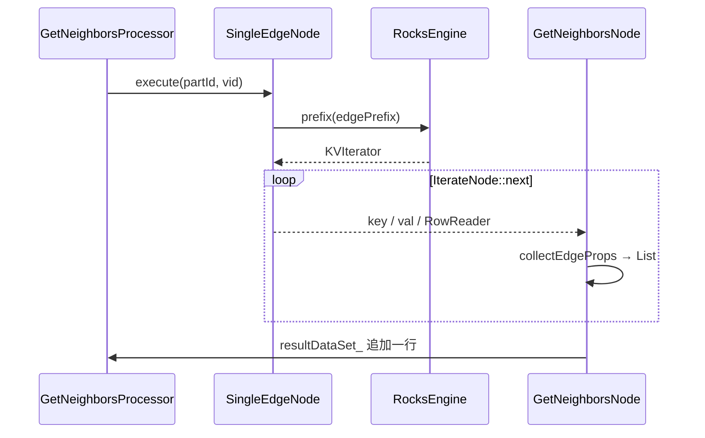

# 14 — 数据流：变量、Iterator、RPC 和存储里的行

> 源码基线与 [13-control-flow](13-control-flow.md) 相同：`v3.8.0` `fa928930`，对照 master `426266b5`。
> 控制流（谁等谁、GO 的计划长什么样）在 [13](13-control-flow.md)。本文只写数据放在哪、游标怎么走、哪一次是拷贝。
> key / 行字节见 [06](06-key-encoding.md)–[09](09-write-read-chain.md)。filter 字符串怎么进 `FilterNode` 见 [04](04-storage-execution.md)。场景二三条查询的列布局和 Thrift / 堆字节见 [20](20-intermediate-representation.md)。
> 分析日期：2026-10-26

---

## 0. 概述

graphd 上，算子之间的通道是 `ExecutionContext` 里的命名变量。变量的值是 `Result`：一份 `shared_ptr<Value>`，加上一个指着这份值的 `Iterator`。下游 `getResult(inputVar).iter()` 得到的是游标，不是一次新的计算。

storaged 上，一个 VID 的边从 RocksDB 的 `KVIterator` 被 `IterateNode::next` 拉出来，在 `GetNeighborsNode` 里收成 `DataSet` 的一行，Thrift 带回 graphd。graphd 的 `GetNeighborsIter` 再在这份嵌套 `DataSet` 上走动。`ExpandAll` 把它摊成普通行，`finish` 进自己的输出变量。

本文沿这个方向写：

1. `Result` / `Iterator` 的所有权。
2. `userCount`、就地删除、异步 GC、内存水位。
3. 管道、`Argument`、`HashInnerJoin` 各拷贝什么。
4. `getNeighbors` 从 graphd 分发到多台 storaged，再合并。
5. GO 和 MATCH 的行长什么样。用 [13](13-control-flow.md) 的两条语句走一遍数据。
6. 写路径上，字节在哪一层出现。编码细节仍指向 [09](09-write-read-chain.md)。

---

## 1. ExecutionContext、Result、Iterator

`SymbolTable::newVariable` 在建变量的同时 `ectx_->initVar(name)`，往 `valueMap_` 里放一个空的 `vector<Result>`。`PlanNode` 构造时用 `__<Kind>_<id>` 做输出变量名，并 `writtenBy`。优化之后有的变量不会再被读，`newVariable` 的注释把这件事留着，没有在建计划时删掉。

`ExecutionContext` 的注释（`src/graph/context/ExecutionContext.h`）：变量的位置在语义分析阶段预留，运行时单个变量被顺序访问，所以运行时不要再增删变量名。map 本身有 `folly::RWSpinLock`。这把锁保的是 map 结构，不是「两个算子同时改同一份 `DataSet`」的行级安全。调度器靠依赖保证一个变量先写完再被读。

```cpp
// src/graph/context/ExecutionContext.h
// name -> Value with multiple versions
std::unordered_map<std::string, std::vector<Result>> valueMap_;
```

`setResult` 把新的 `Result` `emplace_back`。`getResult` 返回 `back()`，也就是最新一份。版本号：`kLatestVersion = 0`，`kPreviousOneVersion = -1`，`kOldestVersion = 1`。`getVersionedResult` 用 `(size + version - 1) % size` 取。历史被谁截断，见下一节的 `truncHistory`。GO / MATCH 的普通 YIELD 只用最新一份。

`Result` 的核是：

| 字段 | 类型 | 作用 |
|------|------|------|
| `value` | `shared_ptr<Value>` | 数据集、标量或空。多个 `Result` / 多个游标可以共享 |
| `iter` | `unique_ptr<Iterator>` | 这份值上的一个游标 |
| `state` | `kUnExecuted` / `kPartialSuccess` / `kSuccess` | `ResultBuilder` 默认 `kSuccess` |
| `checkMemory` | bool | 传到迭代器。查询节点在 `finish` 里按 `node()->isQueryNode()` 设上 |

`Result::iter() const&` 调用 `core_.iter->copy()`，返回新游标，`Value` 仍是同一份 `shared_ptr`。`Result::Core` 的拷贝构造同样：`value = c.value`，`iter = c.iter->copy()`。`SequentialIter` 的拷贝构造把 `rows_` 指到 `valuePtr->mutableDataSet().rows`。两个游标移动时改的是同一条 `vector<Row>`。

`ResultBuilder::build` 在没设迭代器时用 `kSequential`；没设 value 且已有迭代器时，用 `iter->valuePtr()`。`ExecutionContext::setValue` 强制 `kDefault`，给标量用。

四种 `Iterator::Kind`：

| Kind | 底下的值 | 谁 `finish` 成这样 | `next()` 走过什么 |
|------|----------|-------------------|-------------------|
| `kDefault` | 任意 `Value`，常常是 bool | `SelectExecutor`、`LoopExecutor` 的条件；`setValue` | 默认迭代器。`PassThroughExecutor` 看到它就认为「还没有数据集」 |
| `kSequential` | `Value` 里的 `DataSet`，`rows` 是 `vector<Row>` | `ResultBuilder` 的默认。`ExpandAll`、`Project`、`Aggregate`、`Argument` 都是这种 | `vector<Row>::iterator`。`size()` 是行数 |
| `kGetNeighbors` | `List`，元素是各 host 的 `GetNeighbors` `DataSet` | `GetNeighborsExecutor::finish`；`ExpandAllExecutor::handleResponse` 在内部临时构造，不作为算子输出 | 按顶点行、再按边展开。`size()` 的注释是边条数，`numRows()` 是顶点数。`FilterExecutor` 注释写它不是线程安全的 |
| `kProp` | 点或边属性的 `DataSet` | `FilterExecutor` 在输入是 `kProp` 时保持这个 kind | 属性行 |

`GetNeighbors` 响应的列形状在 [09](09-write-read-chain.md)：`_vid`、stats、tag 列、edge 列（`list<list<Value>>`）、expr 列。`GetNeighborsIter` 把这个嵌套结构看成「当前边」。它不向 storaged 再要下一条。

`ExpandAllExecutor` 内部用 `GetNeighborsIter` 把 RPC 读完，`buildResult` 逐列 `eval` 出 `Value`，推进自己的 `result_`（普通 `DataSet`）。`finish` 时 `ResultBuilder` 默认套 `SequentialIter`。所以 `ExpandAll` 的下游看到的是摊平的行，不是 `GetNeighborsIter`。直接的 `GetNeighbors` 算子（最短路那条）才会把 `kGetNeighbors` 放进变量，让上面的 `Filter` 就地 `erase`。

---

## 2. 何时拷贝、何时释放、内存谁卡住

### 2.1 userCount

`FLAGS_enable_lifetime_optimize` 默认 true。`Scheduler::analyzeLifetime` 给每个输入变量的 `userCount` 加一。根输出和 `Select` / `Loop` 的输出被写成 `uint64` 最大值。

`Executor::finish`：

- 优化关掉，或者输出变量的 `userCount != 0`：`setResult`，行数记进 profile。
- 优化开着且 `userCount == 0`：这份结果没有读者，不写入 context。日志是 `Drop variable`。
- 然后调用 `drop()`。

`drop` 对每个输入变量 `userCount.fetch_sub(1)`。减到 0 就 `ectx_->dropResult`。`FLAGS_enable_async_gc` 默认 false，直接 `vector::clear()`。打开时把 `vector<Result>` move 进 `GC` 的 `UMPMCQueue`，后台线程释放。`GC` 的注释说这是为了大查询的中间结果不要占着执行线程做析构。

`Loop` 的 body 不在算子自己的 `drop` 里释放。`loopLayers() != 0` 的节点直接 return，等最外层 `Loop` 的 `finally_` 为真（条件已经是 false）再 `dropBody`。`Select` 的 `drop` 只释放没走过的那一支。生产计划里没有 `Select`，这条路径现在只有测试能走到，见 [13](13-control-flow.md)。

### 2.2 就地删行还是拷一行

`Executor::movable`：输入变量的 `userCount == 1` 时，当前算子是最后一个读者，可以改这份 `DataSet`。`Loop` 体内除了 `Filter` 都返回 false，注释写 “Guaranteed forward compatibility of go statement execution behavior”。`Select` 也返回 false。

`FilterExecutor::handleSingleJobFilter` 用这个标志：

- `canMoveData` 为真：`builder.value(result.valuePtr())`，条件和读者共享同一个 `DataSet`，不满足的行 `iter->erase()` 或 `unstableErase()`（`eraseBySwap`，打乱顺序）。
- 为假：注释写要避免并发读写，把满足条件的行拷进新的 `DataSet`。
- 输入是 `GetNeighborsIter` 时强制 `canMoveData = true`。注释：复用 GetNeighbors 的 dataset，避开一部分 GO 计划的问题。

`handleJob` 在多线程分支里即使可以移动，也是 `auto row = *iter->row()` 再 `move` 进本批的 `DataSet`。`*row()` 是拷贝，`move` 只把这份拷贝交出去。多线程过滤的输出是新 `DataSet`。默认 `max_job_size = 1`，走的是上面的单线程分支。

`ProjectExecutor` 同样走 `runMultiJobs`（`max_job_size > 1`）或单线程。每行是表达式 `eval` 出来的新 `Value`，列数通常比输入少。输入行本身是否销毁，取决于之后 `drop` 把 `userCount` 减到 0。

`QueryInstance::fillRespData` 对根的输出变量 `moveValue`：把 `Result` 里的 `Value` move 进 `ExecutionResponse.data`。这是整次查询最后一次把 `DataSet` 交出去，发生在所有算子 `finish` 之后。列名空则 `E_EXECUTION_ERROR`。

### 2.3 内存水位

两道闸，都是事后拒绝，不是配额分配器：

| 位置 | 行为 |
|------|------|
| `QueryEngine` 的 `graph-memory-monitor` | 每秒 `MemoryUtils::hitsHighWatermark`，结果放进 `kHitMemoryHighWatermark` |
| `Executor::open` | 查询节点看到水位已满，返回错误，文案里带 `FLAGS_system_memory_high_watermark_ratio` |
| `runExecute` 的 `MemoryCheckGuard` | 当前线程上的内存记账。`bad_alloc` 收成 `E_GRAPH_MEMORY_EXCEEDED` |
| `Iterator::valid` | `checkMemory_` 为真时，`hitsSysMemoryHighWatermark` 会让 `valid()` 变成 false，循环停下来 |
| storaged `GetNeighborsProcessor::process` | `MemoryCheckScope` 包住 `doProcess`。多 part 并行那条在 `via` 里再套 `MemoryCheckGuard`，超限记 `E_STORAGE_MEMORY_EXCEEDED` |

`StorageClient::collectResponse` 在发 RPC 前用 `MemoryCheckOffGuard`，把各 host 的响应收齐之后再打开 `MemoryCheckGuard`。合并发生在记账重新打开的线程上。

`truncHistory(name, numVersionsToKeep)` 只留 `vector<Result>` 尾部。调用点不在 GO 的主路径上；版本化变量（`UnionAllVersionVar` 那类）才会堆多份 `Result`。GO 每步的行在 `ExpandAll` 的成员 `result_` 里累加，不是同一个变量的多版本。

---

## 3. 算子之间数据怎么交

生产者 `finish` → `setResult(outputVar)`。消费者 `getResult(inputVar)`。变量名在计划期就连好：`SingleInputNode` 读依赖的 `outputVar`，管道由 `PipeValidator` 把右支的 `inputVar` 设成左支 root 的 `outputVar`。

三条例外，数据形状会变：

**Argument。** 从 `inputVar` 的游标里取 `alias` 那一列。`isInputVertexRequired` 为假时（GO 的起点、终点 VID）接受标量、list、set，放进 `VidHashSet` 去重，输出单列 `DataSet`。这是一份新的行数组，VID 被拷进新 `Row`。`GoPlanner` 对管道上的非 simple GO 用它当 `Expand` 的输入。

**HashInnerJoin。** `BinaryInputNode` 同时 `readVariable` 左右输出。probe 侧在 `max_job_size > 1` 时 `runMultiJobs`，每个区间一份局部命中行，`gather` 再拼。默认单线程，仍然把命中的左右列放进新的 `DataSet`。场景二里左表是 LOOKUP 的 VID 行，右表是 `ExpandAll` 的行，probe key 是 `_expand_vid`。连接后的列是左表列名接上右表列名（`GoPlanner::doPlan` 自己 `setColNames`，和 `HashJoin` 构造函数里「右列名不与左重复才追加」是两次设置，以 planner 这次 `setColNames` 为准）。

**PassThrough。** 不产生新行。输出变量上已经有非默认、非空的迭代器就返回；否则写入一个只有列名、零行的 `DataSet`。0 步 GO 用它把 YIELD 列名交出去，行是空的。

`Select` / `Loop` 的条件 `eval` 出一个 `Value`，`finish` 成 `kDefault`。调度器读的是这个 bool，不把 body 的行流过 `Loop` 节点。body 的行留在 body 自己的输出变量里。最短路的 `DataCollect` 再去读 path 算子的变量。

---

## 4. graphd → storaged → graphd

`StorageClient::getNeighbors`（`src/clients/storage/StorageClient.cpp`）先 `clusterIdsToHosts`：`metaClient_->partId(numParts, vid)`，再查这个 part 的 leader。同一个 leader 上的 VID 按 part 放进 `parts` map，一个 host 一份 Thrift 请求。RPC 次数约等于「至少有一个 VID 的 leader 数」，不是 VID 个数。这个结论在 [11](11-scenario2-beauty-buyers.md) 用过，这里是它的函数。

`collectResponse`（`StorageClientBase-inl.h`）：

1. 对每个 host `getResponse`。future 挂在 IO 线程的 `EventBase` 上，编码和发送在那条线程。
2. `folly::collectAll` 等全部 host。先返回的结果留在 `Try` 里，不会提前交给 `ExpandAll`。
3. 成功的 `Response` `addResponse`。`failed_parts` 非空则 `markFailure`，按 part 记下错误码。异常或 `Status` 失败时，把该请求的全部分区记成 `E_RPC_FAILURE`（内存超限则 `E_GRAPH_MEMORY_EXCEEDED`）。
4. `E_LEADER_CHANGED` 时用响应里的 leader 更新缓存，这次 VID 仍然算失败。

`ExpandAllExecutor::handleResponse` 把每份响应的 `vertices` `DataSet` move 进一个 `List`，`make_shared<Value>`，再 `GetNeighborsIter`。各 host 的行在这个 `List` 里依次被游标扫到，没有按 VID 做跨 host 排序。`handleCompleteness` 在 `FLAGS_accept_partial_success`（默认 false）且完整度不是 100 时返回错误，`result_` 不会 `finish`。

storaged 侧一个 VID 的数据：



`collectEdgeProps` 用 `RowReaderWrapper` 把行字节解成 `Value`。null bitmap、schema version 在这里结束，graphd 看到的是 `Value`。解法见 [07](07-row-encoding.md)、[09](09-write-read-chain.md)。`limit_` 在循环里截断，被截掉的边不会进 `List`。`FilterNode::check` 在 `next()` 的 while 里，滤掉的边同样不会进 `List`。

`GetDstBySrc` 更短：`SingleEdgeKeyIterator` 可以不解码 value，响应是 dst 的 `DataSet`。`ExpandExecutor` 在不需要 `joinInput`、没有每步 LIMIT 时用它走前缀步。`ExpandAll` 只有 `vertexColumns_` 和 `edgeColumns_` 都空时才走 `GetDstBySrc`；普通 YIELD 带了属性，走 `getNeighbors`。

`FLAGS_query_concurrently` 为真时，每个 part 一份 `DataSet`，最后 `append`。行的顺序按 `req.get_parts()` 的遍历顺序接上，不是 VID 序。默认 false，单线程按 part、再按 VID 顺序 `plan.go`，行序就是这个循环序。

索引扫描是 `IndexNode::next` 一次一行 `Row`，`LookupProcessor` 把行收进响应。`IndexSelectionNode::filter` 对当前 `Row` `eval`。这仍然是收齐后整包返回给 graphd 的 `IndexScanExecutor`，graphd 上再 `finish` 成一份 `DataSet`。

---

## 5. GO 和 MATCH 的行

### 5.1 GO

`ExpandAllExecutor.h` 约定最终 `result_` 的列：用户要的起点属性、边属性，`joinInput` 时最前面再加 `_expand_vid`，`joinDst` 时边属性末尾带 dst 供 `HashLeftJoin`。`buildResult` 在非最后一跳会丢掉 `eList` 的最后一个元素，那个位置是为了下一步临时放进去的 dst；`isLastStep` 为真时整份 `eList` 都留下。

M TO N 的多跳行在同一个 `result_.rows` 里顺序 append。第 M 步的一行和第 M+1 步的一行列相同，没有「这是第几步」的额外列。步数差在内容上：它们来自不同深度的 dst。计数器怎么对应到步数，见 [13](13-control-flow.md) 的表。

`adjList_` 是 `unordered_map<Value, vector<List>>`，value 里是这个 VID 已经扫到的边属性加一份顶点属性。它活在 `ExpandAllExecutor` 成员上，不进 `ExecutionContext`。`finish` 只交 `result_`。下一步若命中缓存，从 `adjList_` 拷进 `result_`，不再持有 RPC 的 `GetNeighborsIter`。

### 5.2 MATCH

`TraverseExecutor` 的成员 `paths_`：下标是路径长度，表的 key 是终点 VID，value 是到达这个 VID 的 path 集合。一步 RPC 的 `GetNeighborsIter` 用来扩展这张表，然后那份 RPC `Value` 可以在 `drop` 时释放。`buildResult` 在所有步结束之后才把 path 写成 `result_` 的行。

`TraverseExecutor.h` 给了一条 path 的物理形状：`[Vertex(a), [Edge(a→b), Vertex(b), Edge(b→c), Vertex(c)]]`。这是 trail（边不重复）。GO 的一行没有这条 path 数组，只有当前跳的属性列。

模式上两条边就是两个 `Traverse`，中间变量是前一个 `Traverse` 的 `DataSet`。后一个 `Traverse` 的 `setSrc` 指向 `_joinkey` 那列，从上一份 `DataSet` 取起点。这是变量交数据，不是共享 `paths_`。

### 5.3 对照

| | 一步 GO 的 `ExpandAll` 输出 | 变步 GO 的 `ExpandAll` 输出 | MATCH `Traverse` 输出 |
|--|----------------------------|-----------------------------|------------------------|
| 容器 | 一个 `DataSet` | 同一个 `DataSet`，多跳 append | 先 `paths_`，最后一个 `DataSet` |
| 一行 | 这一跳的 YIELD 列 | 某一跳的 YIELD 列，列集合相同 | 一条 trail |
| 中间跳的 VID | 在 `Expand` 的输出变量里，`ExpandAll` 读完后按 `userCount` 释放 | 同左。M 之前的跳只有 VID | 在 `paths_[i]` 里，直到 `buildResult` |
| 跨 host | 各 host 的 `DataSet` 放进一个 `List`，游标顺序扫 | 每一步都这样 | 每一步都这样 |
| 去重 | 语句写了 `DISTINCT` 才有 graphd `Dedup`。`getDstBySrc` 在 host 内去重 dst | 同左 | `Traverse::setDedup` 是存储侧「这个顶点的邻居行」。`RETURN DISTINCT` 另有 graphd `Dedup`，见 [10](10-pushdown-capability.md) |

---

## 6. 两条语句的数据

计划和控制流在 [13](13-control-flow.md)。这里只跟行。

### 6.1 `GO 2 TO 3 STEPS FROM "a" OVER follow YIELD follow._dst`

假设 `follow._dst` 使 `edgeColumns_` 非空，于是 `ExpandAll` 走 `getNeighbors` 而不是 `GetDstBySrc`。没有 WHERE，优化器没有 filter 可推。

1. 常量起点进 `Expand` 的输入变量，一行，一列，值是 `"a"`。`Expand` 步数为 1，`getDstBySrc`。各 storaged 只返回 dst。graphd 收成下一跳 VID 的 `DataSet`，`_dst` 在 host 内已经去重，跨 host 的重复还在。
2. `ExpandAll::buildRequestVids` 从这份额 `DataSet` 的最后一列把 VID 放进 `nextStepVids_`（`unordered_set`，这里再去一次重）。
3. 第一次 `getNeighbors`：请求体是这些 VID、`follow` 的 `_dst`（`doBuildEdgeProps` 至少放 `kDst`）。`collectAll` 之后 `GetNeighborsIter` 逐边 `eval` 边列，`buildResult(..., isLastStep=false)` 丢掉临时 dst，把第 2 步的行 append 到 `result_`。下一跳 VID 进入 `nextStepVids_` 或 `adjList_`。
4. 第二次 `getNeighbors`：`handleLastStep`，`isLastStep=true`，第 3 步的行继续 append。
5. `finish` 把 `result_` move 进 `ExpandAll` 的输出变量，`SequentialIter` 指着这些行。
6. `Project` 按改写后的 YIELD 再求值，新 `DataSet` 只有 `follow._dst` 那一列。`userCount` 归零后，`ExpandAll` 的那份更宽的 `DataSet` 被 `dropResult`。
7. `fillRespData` `moveValue` 到响应。

第 2 步和第 3 步的行在同一次响应里，客户端看不到步号列。`Expand` 那一跳的 VID 数据集不在最终响应里。

### 6.2 场景二：`LOOKUP | GO`，再聚合

```ngql
LOOKUP ON item WHERE item.type == "beauty" YIELD id(vertex) AS id
| GO FROM $-.id OVER buy REVERSELY
    WHERE buy.ts > now() - 7776000
    YIELD buy._dst AS uid, buy.amount AS amt
| GROUP BY $-.uid YIELD $-.uid AS uid, sum($-.amt) AS sales
| ORDER BY $-.sales DESC
| LIMIT 100
```

索引 key 的字节见 [08](08-index-key-encoding.md)。这里的数据是：

1. `IndexScan` 在每个 part 上 `IndexNode::next`，`type == "beauty"` 能收成前缀时，范围之外的索引项不会变成行。命中的 VID 收成 `DataSet`，第 0 列是 `id(vertex)`。非全文 LOOKUP 没有 `GetVertices`，见 [11](11-scenario2-beauty-buyers.md)。
2. `Argument` 读这一列，去重，输出单列 VID。`Expand` 步数 0，不发 RPC，把这些 VID 写成 `_expand_vid` 和 dst 两列（`joinInput` 时 0 步的两列都是起点）。
3. `ExpandAll` 一次 `getNeighbors`。优化器打开时 `buy.ts > now() - 7776000` 已经在 `ExpandAll.filter` 里，storaged `FilterNode` 丢掉窗口外的边，那些边的 `amount` 不会出现在 Thrift 响应里。`edgeProps` 至少含 `_dst`、`ts`、`amount`。`now()` 在每个 storaged 上各自求值，见 [11](11-scenario2-beauty-buyers.md)。
4. `buildResult` 生成的行带 `_expand_vid`，供 `HashInnerJoin` 和 LOOKUP 的 `id` 对齐。同一个用户从不同商品买到的多条边是多行。
5. `Project` 收成 `uid`、`amt` 两列。
6. `Aggregate` 按 `uid` 建新的哈希表，输出 `uid`、`sales`。这一步的输入行在 `userCount` 归零后释放。存储侧的 `AggregateNode` 不会做这个分组，见 [10](10-pushdown-capability.md)。
7. `TopN` 在这份聚合结果上保留 100 行，再 `moveValue` 给客户端。

跨 host 的同一个 `uid` 在第 4 步各出现一次，聚合在 graphd 把 `sum` 加完。没有任何一个 storaged 看到全部销售额。

MATCH 把同一件事写成一条变长或定长模式时，数据停在 `Traverse` 的 path 上，而不是 `ExpandAll` 的属性行。`RETURN DISTINCT id(u)` 的去重是 path 末端的 VID 上的 graphd `Dedup`。边过滤仍然可以在每跳的 `getNeighbors` 里做。两边的 RPC 合并方式相同，行的形状不同。

---

## 7. 写路径上的数据，只到提交

读路径的 `Value` 和写路径的行字节在 [09](09-write-read-chain.md)。控制流在 [13](13-control-flow.md) 第 7.1 节。数据经过的形态：

| 阶段 | 字节 |
|------|------|
| graphd `InsertVerticesValidator` / `InsertEdgesValidator` | 属性是 `vector<Value>`，放进 `NewTag` / `NewEdge`。整数 VID 在 `StorageClient::getIdFromNewVertex` 收成 8 字节 |
| Thrift | `common.thrift` 的 `Value` union。不是 `RowWriterV2` 的字节 |
| `Add*Processor` | `encodeRowVal` → `RowWriterV2::finish`。正向边和反向边各一行，通常两个 part、两次 `asyncMultiPut` |
| `Part::asyncMultiPut` | `encodeMultiValues(OP_MULTI_PUT, keyValues)` 成为一条 Raft log |
| 多数派接受之后 | `commitBatchWrite` 把 batch 写入本机 RocksDB |

查询再读到这些 key 时，走的是 leader 本机的 `prefix` / `get`，不读 Raft log。leader 切换之前，旧 leader 上的 RocksDB 可能还没有这次提交；`E_LEADER_CHANGED` 让 graphd 更新 leader 缓存，本次查询的那部分 part 失败。默认不接受部分成功。
